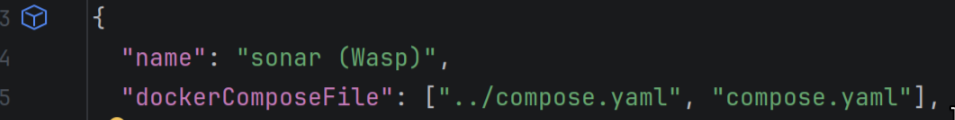

# Informacije

- [DNEVNIK.md](https://github.com/ivrdo/SWE-Project-FER-2026/blob/master/docs/DNEVNIK.md) - Dnevnik rada
- [PROCES.md](https://github.com/ivrdo/SWE-Project-FER-2026/blob/master/docs/PROCES.md) - Način rada tima, projektni alati...
- [ARHITEKTURA.md](https://github.com/ivrdo/SWE-Project-FER-2026/blob/master/docs/ARHITEKTURA.md) - Softwareska arhitektura

## Instalacija za rad na projektu

Općenito je potrebno instalirati sljedeći software:

- Node.js >= 24.14.1
- Wasp CLI 0.26: `npm i -g @wasp.sh/wasp-cli@0.26`
- Docker Desktop / samo Docker uz Compose
- Git
- IntelliJ IDEA

*__Obavezno pročitati upute koje olakšavaju instalaciju.__*

## Windows

- Na Windowsu je potrebno instalirati IntelliJ IDEA, Docker Desktop i Git.
    - Git: https://git-scm.com/install/windows
    - IntelliJ IDEA: https://www.jetbrains.com/idea/download/?section=windows, https://www.youtube.com/watch?v=E2QMyGgYLoM
    - Docker Desktop: https://docs.docker.com/desktop/setup/install/windows-install/
- Postaviti svoj `user.name` i `user.email` **obavezno** s `git.config --global user.name <ime>` i `git.config --global user.email <ime>`
- Na otvaranje projektnog direktorija, ignorirati popup-e i pronaći `.devcontainer/devcontainer.json`, otvara se ovakav prozor:
  
- Odabrati plavu kockicu u gornjem lijevom kutu
- `Create Dev Container and Copy Sources...`, odabrati branch `docker-wasp`, potvrditi
- Na kraju instalacije će biti popup, stisnuti default izbor "This window"
- Pronaći `wasp/schema.prisma`, i stisnuti, ponudit će instalaciju plugina, instalirati
- Provesti set up naredbe

## MacOS

- Na MacOS je potrebno instalirati IntelliJ IDEA, Docker Desktop i Git.
    - Git: https://git-scm.com/install/mac
    - IntelliJ IDEA: https://www.jetbrains.com/idea/download/?section=mac, https://www.youtube.com/watch?v=E2QMyGgYLoM
    - Docker Desktop: https://docs.docker.com/desktop/setup/install/mac-install/
- Postaviti svoj `user.name` i `user.email` **obavezno** s `git.config --global user.name <ime>` i `git.config --global user.email <ime>`
- Na otvaranje projektnog direktorija, ignorirati popup-e i pronaći `.devcontainer/devcontainer.json`, otvara se ovakav prozor:
  
- Odabrati plavu kockicu u gornjem lijevom kutu
- `Create Dev Container and Copy Sources...`, odabrati branch `docker-wasp`, potvrditi
- Na kraju instalacije će biti popup, stisnuti default izbor "This window"
- Pronaći `wasp/schema.prisma`, i stisnuti, ponudit će instalaciju plugina, instalirati
- Provesti set up naredbe

## Linux

- Instalirati Docker binary s compose pluginom i IntelliJ IDEA
- Provesti set up naredbe
- Na Linuxu je potrebno instalirati IntelliJ IDEA (package), docker (package, uz compose plugin) i git (package).
    - Git: https://git-scm.com/install/linux
    - IntelliJ IDEA: https://www.jetbrains.com/idea/download/?section=linux, https://www.youtube.com/watch?v=E2QMyGgYLoM
    - Docker Desktop: https://docs.docker.com/desktop/setup/install/linux/
- Postaviti svoj `user.name` i `user.email` **obavezno** s `git.config --global user.name <ime>` i `git.config --global user.email <ime>`
- Na otvaranje projektnog direktorija, ignorirati popup-e i pronaći `.devcontainer/devcontainer.json`, otvara se ovakav prozor:
  
- Odabrati plavu kockicu u gornjem lijevom kutu
- `Create Dev Container and Copy Sources...`, odabrati branch `docker-wasp`, potvrditi
- Na kraju instalacije će biti popup, stisnuti default izbor "This window"
- Pronaći `wasp/schema.prisma`, i stisnuti, ponudit će instalaciju plugina, instalirati
- Provesti set up naredbe

## Prvo pokretanje

Iz korijena repozitorija:

```sh
cd wasp
cp .env.server.example .env.server
wasp install
wasp db migrate-dev
wasp start
```

- klijent: http://localhost:3000
- server: http://localhost:3001

## Bitno

__*Bitno je ne brisati svoj dev container osim ako niste napravili commit.*__

__*Na isti dev container se kasnije možete spojiti.*__

```sh
# U dev containeru
cd wasp
# wasp db migrate-dev # (ažuriranje baze ako je netko mijenjao shemu)
wasp start
```

Kad netko commita nove migracije, prije `wasp start` pokrenuti `wasp db migrate-dev`.

## Nakon promjene `schema.prisma`

1. Zaustaviti `wasp start`. Wasp ne dopušta dvije naredbe nad istim projektom
   istovremeno.
2. `wasp db migrate-dev`
3. Commitati novu mapu u `migrations/` zajedno s promjenom sheme.

## Baza

- lozinka je `dev`, osim ako je u `../.env` postavljen `DB_PASSWORD`. Lozinka u
  `DATABASE_URL` u `.env.server` mora biti ista.
