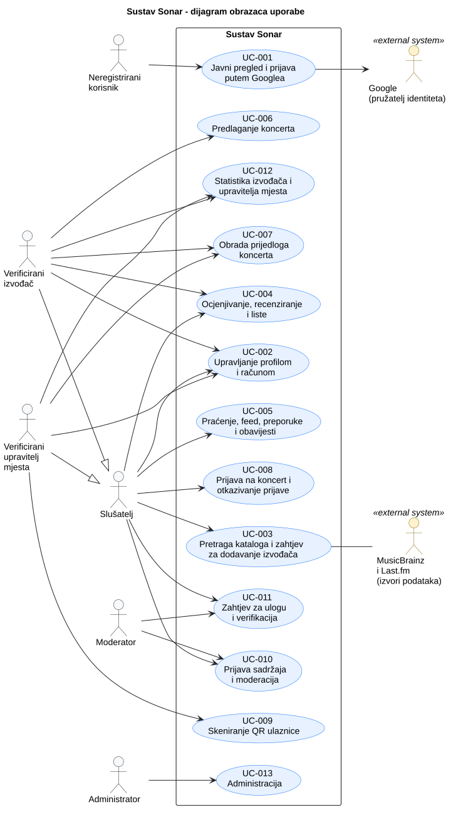

# 3. Obrasci uporabe

## 3.1 Dijagram obrazaca uporabe

Dijagram prikazuje granicu sustava Sonar, aktere i njihove glavne ciljeve. Verificirani izvođač i verificirani upravitelj mjesta imaju sve mogućnosti slušatelja, a Google te MusicBrainz i Last.fm sudjeluju kao vanjski sustavi.

**Slika 3.1. Dijagram obrazaca uporabe sustava Sonar**

**PlantUML izvor:** [izvor](./puml/3-1-sonar-system-UC.puml)

## 3.2 Specifikacije obrazaca uporabe

Svaki obrazac iz dijagrama opisan je tablicom s primarnim akterom, povezanim zahtjevima, preduvjetima, glavnim uspješnim tokom, alternativnim tokovima i posljedicama.

### UC-001: Javni pregled i prijava putem Googlea

| Element specifikacije | Opis |
| :--- | :--- |
| **Primarni akter** | Neregistrirani korisnik (sekundarni akter: Google) |
| **Povezani zahtjevi** | F-001, F-002 |
| **Preduvjeti** | Korisnik nije prijavljen. Za prijavu: Google je dostupan. |
| **Glavni uspješni tok** | 1. Korisnik otvara početnu stranicu. Sustav prikazuje najavljene koncerte, popularne izvođače i mjesta te navodi izvore podataka. 2. Korisnik otvara kartu, a sustav prikazuje mjesta i koncerte. 3. Za prijavu na koncert, preporuke ili druge radnje korisnik odabire „Nastavi s Googlom“ na stranici prijave. 4. Sustav ga preusmjerava na Google. 5. Korisnik se prijavljuje na Googleu i potvrđuje pristup. 6. Google vraća korisnika u aplikaciju s adresom e-pošte. 7. Sustav traži račun s tom adresom. Ako ga nema, stvara ga. 8. Sustav prijavljuje korisnika i izdaje token. Novi korisnik nastavlja na onboarding (UC-002), a postojeći na početnu stranicu. |
| **Alternativni tokovi / Iznimke** | **1a. Nema najavljenih koncerata:** sustav prikazuje poruku. **2a. Usluga za kartu nije dostupna:** prikazuje se popis mjesta bez karte. **3a. Radnja koja traži prijavu odabrana bez prijave:** sustav preusmjerava na prijavu. **4a. Google nije dostupan ili prijava ne uspije:** sustav prikazuje poruku i nudi ponovni pokušaj. **5a. Odustajanje:** korisnik odustaje na Googleu i ostaje neprijavljen. Pregled karte i popularnih izvođača i dalje je dostupan. **7a. Račun je suspendiran, deaktiviran ili obrisan:** sustav odbija prijavu uz poruku (za suspendirani račun navodi se do kada). |
| **Posljedice (ishod)** | Korisnik je pregledao javne podatke (bez promjene stanja). Nakon prijave korisnik je prijavljen (izdan je token), a pri prvoj prijavi nastao je račun. |

### UC-002: Upravljanje profilom i računom

| Element specifikacije | Opis |
| :--- | :--- |
| **Primarni akter** | Slušatelj (profil izvođača: verificirani izvođač; profil mjesta: verificirani upravitelj mjesta) |
| **Povezani zahtjevi** | F-003 – F-006, F-046, F-047 |
| **Preduvjeti** | Korisnik je prijavljen. |
| **Glavni uspješni tok** | 1. Pri prvoj prijavi sustav otvara onboarding. 2. Korisnik odabire nekoliko omiljenih žanrova i izvođača iz kataloga. 3. Korisnik unosi mjesto stanovanja, odabire kanale obavijesti (e-pošta, unutar aplikacije) i najveću udaljenost za obavijesti o koncertima. 4. Sustav sprema odabir i otvara početnu stranicu s preporukama. 5. Kasnije korisnik na profilu uređuje ime ili nadimak, mjesto, opis i postavke obavijesti te sprema promjene. 6. Verificirani izvođač uređuje biografiju svojeg profila, a verificirani upravitelj mjesta unosi kapacitet mjesta. 7. Slušatelj otvara „Moji podaci“. 8. Odabire „Preuzmi podatke“, a sustav priprema datoteku sa svim njegovim podacima. 9. Za brisanje računa čita posljedice, označava potvrdu i odabire „Izbriši račun“. 10. Sustav anonimizira korisnika: briše e-poštu, ime, opis i lokaciju te praćenja, liste, obavijesti i preporuke. Recenzije i evidencija prijava ostaju anonimne, a zapisnik moderatora ostaje nepromijenjen. 11. Sustav odjavljuje korisnika. |
| **Alternativni tokovi / Iznimke** | **3a, 5a. Nevaljan unos:** prazno ime ili nepoznato mjesto. Sustav prikazuje poruku uz polje i ne sprema promjene. **6a. Kapacitet nije unesen ili nije veći od nule:** sustav ga ne prihvaća. Dok kapacitet nije unesen, na mjesto nije moguće predložiti koncert. **9a. Potvrda nije označena:** brisanje nije moguće. **9b. Odustajanje:** ništa se ne mijenja. |
| **Posljedice (ishod)** | Profil i postavke su spremljeni, a odabir žanrova i izvođača polazište je za preporuke. Nakon brisanja računa korisnik se ne može prijaviti, recenzije i prijave su anonimne, a zapisnik moderatora je netaknut. |

### UC-003: Pretraga kataloga i zahtjev za dodavanje izvođača

| Element specifikacije | Opis |
| :--- | :--- |
| **Primarni akter** | Slušatelj (sekundarni akteri: MusicBrainz i Last.fm) |
| **Povezani zahtjevi** | F-007 – F-010 |
| **Preduvjeti** | Korisnik je prijavljen. |
| **Glavni uspješni tok** | 1. Slušatelj upisuje pojam u pretragu. 2. Sustav vraća rezultate iz vlastitog kataloga, grupirane po vrsti (izvođači, izdanja, pjesme, mjesta). 3. Slušatelj otvara stranicu izvođača, albuma, pjesme ili mjesta. Stranica navodi izvore podataka (MusicBrainz, Last.fm). 4. Ako traženog izvođača nema, slušatelj odabire „Zatraži dodavanje izvođača“. 5. Sustav bilježi zahtjev. Izvođač je u stanju „u obradi“ i ne ulazi u preporuke, a podaci se u pozadini dohvaćaju s MusicBrainza i Last.fma. 6. Kad je dohvat gotov, izvođač prelazi u „dohvaćen“ i postaje dostupan u katalogu. |
| **Alternativni tokovi / Iznimke** | **2a. Nema rezultata:** sustav prikazuje poruku i nudi zahtjev za dodavanje (korak 4). **5a. Izvođač već postoji (isti MusicBrainz identifikator):** sustav ne dohvaća ponovno, nego otvara postojeći zapis. **5b. Vanjski servis nije dostupan:** katalog radi dalje, ali se novi izvođač ne može dodati. **6a. Dohvat ne uspije:** sustav ga ponavlja ograničen broj puta uz odgodu. Ako ni tada ne uspije, stanje je „neuspjelo“ i korisnik vidi da izvođača još nema u katalogu. |
| **Posljedice (ishod)** | Izvođač je u katalogu sa stanjem „dohvaćen“ ili je zahtjev završio kao „neuspjelo“. |

### UC-004: Ocjenjivanje, recenziranje i liste

| Element specifikacije | Opis |
| :--- | :--- |
| **Primarni akter** | Slušatelj (službeni odgovor: verificirani izvođač) |
| **Povezani zahtjevi** | F-012 – F-015 |
| **Preduvjeti** | Korisnik je prijavljen. Stavka (izvođač, album ili pjesma) postoji u katalogu. |
| **Glavni uspješni tok** | 1. Slušatelj otvara stranicu izvođača, albuma ili pjesme. 2. Odabire ocjenu od 1 do 5 i/ili „sviđa mi se“. 3. Sustav sprema ocjenu i prikazuje je uz stavku. 4. Slušatelj odabire „Napiši recenziju“, upisuje tekst i objavljuje ga. 5. Sustav sprema recenziju i prikazuje je na stranici stavke uz ime autora. 6. Verificirani izvođač na recenziju svojeg izdanja javno odgovara službenim odgovorom, koji se prikazuje uz recenziju. 7. Slušatelj u profilu otvara „Liste“, odabire „Nova lista“, upisuje naziv i sprema listu (poželjno). 8. Dodaje pjesme odabirom „+“ uz pjesmu na stranici albuma, izvođača ili u pretrazi te po želji mijenja redoslijed ili ih uklanja. 9. Sustav sprema listu s pjesmama u zadanom redoslijedu. |
| **Alternativni tokovi / Iznimke** | **2a. Ponovna ocjena iste stavke:** nova ocjena zamjenjuje prethodnu. **4a. Prazna recenzija:** sustav je ne sprema i prikazuje poruku. **6a. Korisnik nije verificirani izvođač tog izdanja:** odgovor nije dopušten. **7a. Prazan naziv:** lista se ne sprema. **8a. Pjesma je već na listi:** sustav to javlja i ne dodaje je ponovno. |
| **Posljedice (ishod)** | Ocjena i recenzija su spremljene i vidljive, a interakcija ulazi u preporuke. Lista je spremljena s pjesmama u zadanom redoslijedu. |

### UC-005: Praćenje, feed, preporuke i obavijesti

| Element specifikacije | Opis |
| :--- | :--- |
| **Primarni akter** | Slušatelj (obavijesti pokreće sustav) |
| **Povezani zahtjevi** | F-011, F-016 – F-020, F-035 – F-038 |
| **Preduvjeti** | Korisnik je prijavljen i ima odabrane kanale obavijesti. Preporuke su izračunate (novi korisnik polazi od odabira pri registraciji i od popularnosti). |
| **Glavni uspješni tok** | 1. Slušatelj na stranici izvođača ili na profilu korisnika odabire „Prati“. 2. Sustav sprema praćenje, a gumb prikazuje stanje „Pratiš“. 3. Slušatelj otvara početnu stranicu. 4. Sustav prikazuje feed: aktivnosti praćenih korisnika (npr. ocjene i recenzije) i novosti praćenih izvođača (npr. najavljene koncerte), od najnovijeg prema starijem. 5. Sustav prikazuje unaprijed izračunate preporuke (računaju se jednom na sat): izvođače koje korisnik još ne prati i koncerte izvođača koje voli u stanju otvorenih prijava, unutar odabranog radijusa (bliži su ispred), uz razlog („jer voliš izvođača X“). 6. Kad se dogodi događaj (potvrđen koncert praćenog izvođača u radijusu korisnika, dan prije koncerta na koji je korisnik prijavljen, otkazan koncert, odluka o zahtjevu za ulogu ili o sadržaju), sustav stvara obavijest i šalje je kanalima koje je korisnik odabrao (e-pošta, unutar aplikacije). 7. Novi unosi i obavijesti pojavljuju se bez osvježavanja stranice. 8. Slušatelj otvara preporučenog izvođača, koncert ili obavijest, ili prekida praćenje odabirom gumba „Pratiš“. |
| **Alternativni tokovi / Iznimke** | **1a. Praćenje samog sebe:** nije dopušteno. **4a. Slušatelj još nikoga ne prati:** feed je prazan, uz poruku. **5a. Novi korisnik ili korisnik bez povijesti:** preporuke polaze od žanrova i izvođača odabranih pri registraciji i od popularnosti. **5b. Izvođač je „u obradi“:** ne pojavljuje se u preporukama. **6a. Izvođač nije praćen ili je mjesto izvan radijusa:** obavijest o novom koncertu ne šalje se. **6b. Odabran samo jedan kanal:** obavijest se šalje samo njime. |
| **Posljedice (ishod)** | Praćenje je spremljeno, a feed prikazuje aktivnosti i novosti praćenih. Korisnik vidi preporuke s razlogom te obavijesti, e-poštom i/ili u aplikaciji. |

### UC-006: Predlaganje koncerta

| Element specifikacije | Opis |
| :--- | :--- |
| **Primarni akter** | Verificirani izvođač |
| **Povezani zahtjevi** | F-021 |
| **Preduvjeti** | Korisnik je verificirani izvođač. Mjesto je u katalogu i ima uneseni kapacitet. |
| **Glavni uspješni tok** | 1. Verificirani izvođač odabire „Predloži koncert“ (na stranici mjesta ili na popisu svojih koncerata). 2. Odabire mjesto iz kataloga, a sustav prikazuje njegov kapacitet. 3. Unosi datum i vrijeme, izvođače koji nastupaju i broj mjesta za prijavu. 4. Sustav provjerava podatke i da broj mjesta ne prelazi kapacitet mjesta. 5. Sustav sprema koncert u stanju „predložen“ s rokom za potvrdu. 6. Upravitelj mjesta vidi prijedlog na popisu prijedloga (UC-007). |
| **Alternativni tokovi / Iznimke** | **1a. Korisnik nije verificirani izvođač:** radnja mu nije dostupna. **2a. Mjesto nema uneseni kapacitet:** prijedlog nije moguć dok upravitelj ne unese kapacitet. **4a. Broj mjesta veći od kapaciteta:** sustav prikazuje poruku uz polje i ne sprema prijedlog. **4b. Nepotpuni podaci:** sustav prikazuje poruku uz polje. |
| **Posljedice (ishod)** | Koncert je u stanju „predložen“ s rokom za potvrdu. |

### UC-007: Obrada prijedloga koncerta

| Element specifikacije | Opis |
| :--- | :--- |
| **Primarni akter** | Verificirani upravitelj mjesta (otkazivanje: izvođač ili upravitelj mjesta) |
| **Povezani zahtjevi** | F-022, F-023 |
| **Preduvjeti** | Korisnik je verificirani upravitelj mjesta. Postoji prijedlog koncerta za njegovo mjesto. |
| **Glavni uspješni tok** | 1. Upravitelj otvara popis prijedloga za svoje mjesto. 2. Odabire prijedlog i pregledava izvođače, datum, broj mjesta i rok za odluku. 3. Odabire „Prihvati“. 4. Sustav postavlja koncert u „potvrđen“, otvara prijave i obavještava pratitelje u radijusu (UC-005). 5. Potvrđeni koncert kasnije može otkazati izvođač ili upravitelj. Koncert postaje „otkazan“, a prijavljeni slušatelji dobivaju obavijest (UC-005). |
| **Alternativni tokovi / Iznimke** | **2a. Rok za odluku je prošao:** koncert je „istekao“ i odluka više nije moguća. **3a. Odbijanje:** upravitelj odabire „Odbij“ i upisuje razlog. Koncert postaje „odbijen“, a izvođač razlog vidi uz koncert. **3b. Odbijanje bez razloga:** sustav ga ne sprema. **5a. Koncert koji nije potvrđen:** ne može se otkazati. |
| **Posljedice (ishod)** | Koncert je potvrđen i otvoren za prijave, odbijen, istekao ili otkazan, a zainteresirani su obaviješteni. |

### UC-008: Prijava na koncert i otkazivanje prijave

| Element specifikacije | Opis |
| :--- | :--- |
| **Primarni akter** | Slušatelj |
| **Povezani zahtjevi** | F-024, F-025, F-027 |
| **Preduvjeti** | Korisnik je prijavljen. Koncert je u stanju otvorenih prijava. |
| **Glavni uspješni tok** | 1. Slušatelj otvara stranicu koncerta u stanju otvorenih prijava. 2. Sustav prikazuje podatke koncerta i raspoloživost mjesta. 3. Slušatelj odabire „Prijavi se“. 4. Sustav provjerava ima li slobodnih mjesta i nema li korisnik već aktivnu prijavu, sprema prijavu u stanju „prijavljen“ i izdaje QR ulaznicu. 5. Sustav prikazuje ulaznicu. Slušatelj po želji dodaje koncert u kalendar (datoteka .ics ili Google Kalendar). 6. Slušatelj može otkazati prijavu najkasnije sat vremena prije početka koncerta. Prijava postaje „otkazan“, a mjesto se oslobađa. |
| **Alternativni tokovi / Iznimke** | **1a. Koncert nije u stanju otvorenih prijava:** prijava nije moguća. **4a. Nema slobodnih mjesta:** sustav odbija prijavu uz poruku i ništa ne sprema. **4b. Već postoji aktivna prijava:** sustav prikazuje postojeću ulaznicu. **6a. Manje od sat vremena do početka:** otkazivanje se odbija uz poruku. **6b. Koncert je otkazan:** prijava više ne vrijedi (UC-007). |
| **Posljedice (ishod)** | Prijava je u stanju „prijavljen“ s QR kodom, a broj slobodnih mjesta je smanjen (pri otkazivanju se vraća). |

### UC-009: Skeniranje QR ulaznice

| Element specifikacije | Opis |
| :--- | :--- |
| **Primarni akter** | Verificirani upravitelj mjesta |
| **Povezani zahtjevi** | F-026, F-028 |
| **Preduvjeti** | Korisnik je verificirani upravitelj mjesta. Slušatelj ima valjanu prijavu za koncert na tom mjestu. |
| **Glavni uspješni tok** | 1. Upravitelj na mobitelu otvara zaslon za skeniranje. 2. Sustav određuje koji je koncert na mjestu u tijeku. 3. Upravitelj usmjerava kameru na QR kod s ulaznice. 4. Sustav provjerava je li kod valjan za taj koncert i još neiskorišten. 5. Sustav prijavu postavlja u „došao“ i prikazuje potvrdu. 6. Po završetku koncerta prijave koje nisu skenirane prelaze u „nije došao“. |
| **Alternativni tokovi / Iznimke** | **3a. Kamera nije dostupna:** sustav prikazuje poruku o pristupu kameri. **4a. Nevaljan kod:** sustav prikazuje poruku i ne mijenja stanje. **4b. Ulaznica je već iskorištena:** sustav prikazuje poruku. **4c. Kod vrijedi za drugi koncert:** sustav prikazuje poruku. |
| **Posljedice (ishod)** | Prijava je „došao“. Prijave koje do kraja koncerta nisu skenirane postaju „nije došao“. |

### UC-010: Prijava sadržaja i moderacija

| Element specifikacije | Opis |
| :--- | :--- |
| **Primarni akter** | Slušatelj (prijava sadržaja) i moderator (obrada prijave) |
| **Povezani zahtjevi** | F-029 – F-032 |
| **Preduvjeti** | Korisnik je prijavljen. Sadržaj (recenzija ili profil) postoji. |
| **Glavni uspješni tok** | 1. Korisnik uz recenziju ili profil odabire „Prijavi“. 2. Odabire razlog, po želji dodaje opis i šalje prijavu. 3. Sustav sprema prijavu u stanju „prijavljeno“. 4. Moderator otvara popis prijava i preuzima prijavu („u obradi“). 5. Moderator odlučuje o uklanjanju sadržaja ili odbacivanju prijave i upisuje razlog. 6. Sustav sprema odluku, zapisuje radnju u zapisnik i obavještava podnositelja i autora (UC-005). 7. Ako je korisniku uklonjen zadani broj sadržaja (zadano tri), sustav mu privremeno suspendira račun. |
| **Alternativni tokovi / Iznimke** | **2a. Razlog nije odabran:** prijava se ne šalje. **5a. Odbacivanje:** sadržaj ostaje vidljiv, a prijava je „odbačeno“. **5b. Odluka bez razloga:** sustav je ne sprema. **7a. Suspendirani korisnik:** ne može se prijaviti do isteka suspenzije (UC-001). |
| **Posljedice (ishod)** | Prijava je „uklonjeno“ ili „odbačeno“, radnja je u zapisniku, a po potrebi je korisnik suspendiran. |

### UC-011: Zahtjev za ulogu i verifikacija

| Element specifikacije | Opis |
| :--- | :--- |
| **Primarni akter** | Slušatelj (zahtjev) i moderator (provjera) |
| **Povezani zahtjevi** | F-032 – F-034 |
| **Preduvjeti** | Korisnik je prijavljen. Izvođač ili mjesto postoji u katalogu (ili je zatraženo dodavanje). |
| **Glavni uspješni tok** | 1. Slušatelj odabire zahtjev za ulogu izvođača ili upravitelja mjesta. 2. Odabire izvođača ili mjesto iz kataloga i navodi poveznicu na službenu stranicu ili profil. 3. Sustav sprema zahtjev i izdaje jedinstveni kod. 4. Korisnik objavljuje kod na toj stranici ili profilu. 5. Moderator otvara zahtjev („provjera“) i provjerava je li kod vidljiv i pripada li stranica izvođaču odnosno mjestu. 6. Moderator potvrđuje zahtjev. Sustav dodjeljuje ulogu, zapisuje radnju u zapisnik i obavještava korisnika (UC-005). |
| **Alternativni tokovi / Iznimke** | **2a. Izvođača ili mjesta nema u katalogu:** korisnik traži dodavanje (UC-003), a zahtjev se nastavlja nakon dohvata. **5a. Kod nije vidljiv ili stranica ne pripada izvođaču ili mjestu:** moderator traži dopunu uz napomenu („potrebna dopuna“), a nakon dopune zahtjev se vraća u „provjeru“. **5b. Odbijanje:** moderator odbija uz razlog, zahtjev je „odbijen“, a korisnik je obaviješten. |
| **Posljedice (ishod)** | Korisnik je dobio ulogu ili je zahtjev odbijen, a ishod je priopćen obavijesti. |

### UC-012: Statistika izvođača i upravitelja mjesta

| Element specifikacije | Opis |
| :--- | :--- |
| **Primarni akter** | Verificirani izvođač i verificirani upravitelj mjesta |
| **Povezani zahtjevi** | F-039 – F-041 |
| **Preduvjeti** | Korisnik je verificirani izvođač ili upravitelj mjesta. |
| **Glavni uspješni tok** | 1. Izvođač ili upravitelj otvara statistiku. 2. Izvođač za svaki svoj koncert vidi prijave, dolaske i nedolaske, prosječne ocjene svojih pjesama i albuma te broj pratitelja u blizini mjesta (zbirno). 3. Upravitelj vidi prijave, dolaske i nedolaske za koncerte na svom mjestu. 4. Izvođač po želji izvozi podatke u CSV. |
| **Alternativni tokovi / Iznimke** | **2a. Pratitelja ispod propisanog praga (npr. deset):** vrijednost se ne prikazuje. **2b. Koncert bez prijava:** prikazuje se bez brojeva dolazaka. **2c. Tuđi koncert ili mjesto:** podaci nisu dostupni. |
| **Posljedice (ishod)** | Podaci su prikazani (samo čitanje), po želji izvezeni u CSV. |

### UC-013: Administracija

| Element specifikacije | Opis |
| :--- | :--- |
| **Primarni akter** | Administrator |
| **Povezani zahtjevi** | F-042 – F-045 |
| **Preduvjeti** | Korisnik je administrator. |
| **Glavni uspješni tok** | 1. Administrator otvara administraciju. 2. Pregledava statistiku sustava: korisnike po ulogama, koncerte po stanjima i odaziv. 3. Pretražuje korisnike i otvara odabranog korisnika. 4. Mijenja ulogu, oduzima ulogu izvođača ili upravitelja ili deaktivira račun, nakon potvrde. 5. Mijenja pravilo suspenzije (broj uklonjenih sadržaja i trajanje) i sprema ga. Pravilo vrijedi odmah. |
| **Alternativni tokovi / Iznimke** | **1a. Korisnik nije administrator:** pristup administraciji nije moguć. **4a. Odustajanje u potvrdi:** ništa se ne mijenja. **5a. Nevaljana vrijednost pravila:** vrijednost mora biti veća od nule, inače se ne sprema. |
| **Posljedice (ishod)** | Promjene su spremljene i vrijede odmah. |

## 3.3 Provjera dosljednosti obrazaca uporabe

Mapiranje zahtjeva na obrasce uporabe i ispitivanja održava se isključivo u [tablici sljedivosti zahtjeva](./2-Analiza-zahtjeva.md#26-sljedivost-zahtjeva).

Svih 13 obrazaca iz tablica u 3.2 nalazi se i na dijagramu 3.1 i u tablici sljedivosti 2.6, a njihovi povezani zahtjevi podudaraju se s tablicom 2.6. Svih 47 funkcijskih zahtjeva pokriveno je barem jednim obrascem uporabe. Akteri u specifikacijama odgovaraju ulogama iz odjeljka 2.3. Demonstracija glavnih tokova i važnih alternativa na izrađenom sustavu još nije provedena.
