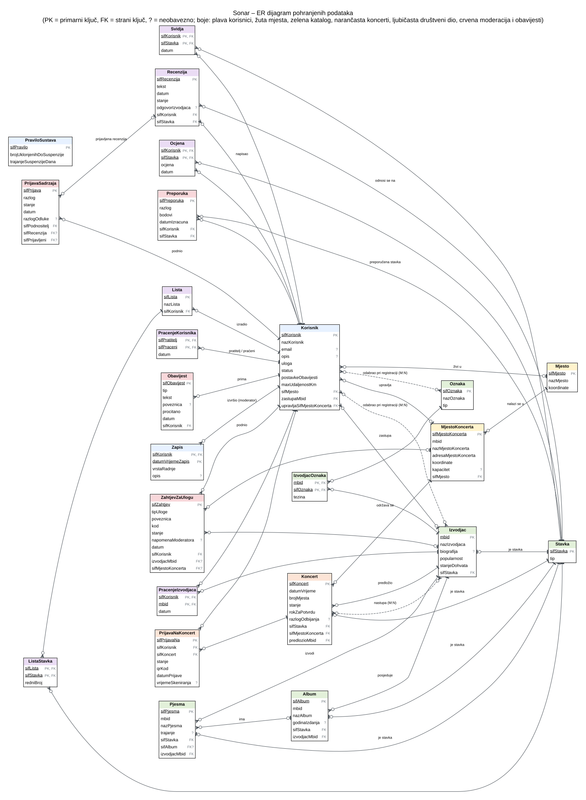
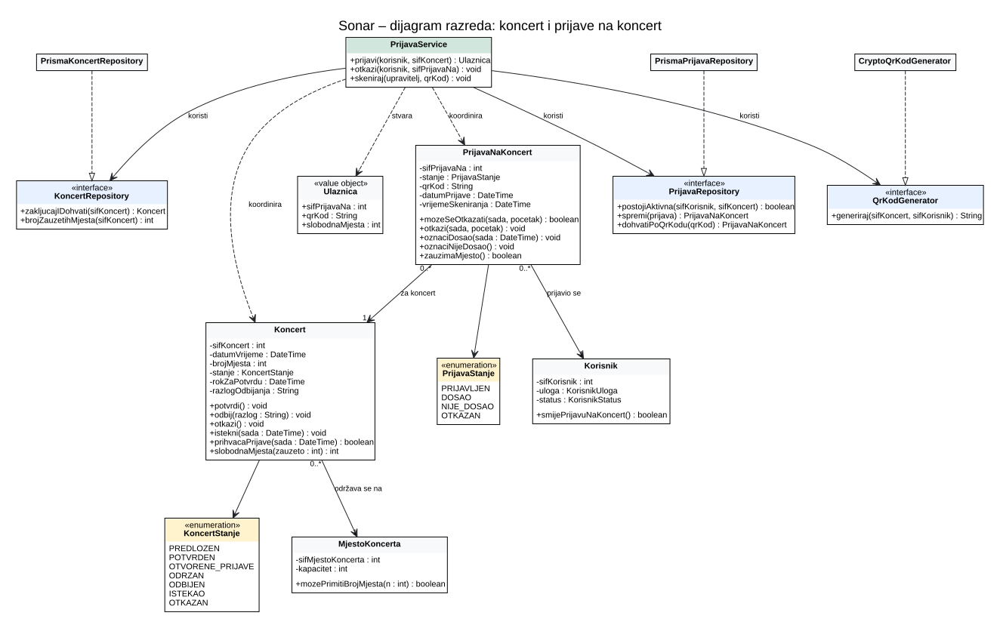

# 4. Arhitektura i oblikovanje

**Cilj:** Definirati arhitekturni stil, dekompoziciju programa na podsustave i module, organizaciju podataka te dinamičko ponašanje tijekom izvođenja. Arhitektura predstavlja temelj za implementaciju i ažurira se pri svakoj važnijoj promjeni projektnih odluka.

| Arhitekturni pogled | Ključno inženjersko pitanje | Primijenjeni model ili dijagram |
| :--- | :--- | :--- |
| **Strategija rješenja** | Koji stil i temeljne odluke određuju program? | Tablica odluka (odjeljak 4.1) |
| **Struktura podsustava** | Koji su glavni dijelovi i kako komuniciraju? | Dijagram komponenata |
| **Model podataka** | Kako su strukturirani trajni podaci programa? | Relacijski ER dijagram |
| **Struktura koda** | Kako su dodijeljene odgovornosti i ključne klase? | Reprezentativni dijagram razreda |
| **Dinamičko ponašanje** | Kako moduli surađuju pri obradi ključnih transakcija? | sekvencijski dijagram |
| **Stanja sustava** | Kako ključni domenski objekt mijenja svoja stanja? | Dijagram stanja |
| **Fizički razmještaj** | Na kojim se izvršnim čvorovima program izvodi? | Dijagram razmještaja (poglavlje 6) |

---

Za svaki UML dijagram čuvajte čitljivu sliku i PlantUML izvor, kako je opisano na stranici [Home](./Home.md). U dovršenoj stranici koristite vlastite projektne odluke i modele.

## 4.1 Ključne arhitekturne odluke

**Cilj:** Objasniti nekoliko arhitekturnih odluka koje najviše utječu na rješenje i navesti njihove projektno specifične razloge.

| Odluka | Razmatrana alternativa | Projektno specifično obrazloženje i kompromis |
| --- | --- | --- |
| **Modularni monolit:**  jedna Wasp aplikacija (React klijent, Node.js poslužitelj i Prisma ORM) s jednom PostgreSQL bazom. | Mikroservisi (katalog, koncerti, preporuke, obavijesti) ili zasebno izrađeni klijent i API. | Podaci Sonara gusto su povezani: ocjene, recenzije, koncerti, prijave i preporuke dijele korisnike i stavke, a prijava na koncert mora biti transakcijska (NF-07). Za opseg ovog projekta jedan razmještaj znači manje rada na integraciji i postavljanju, a zasebni klijent i API zahtijevali bi povezivanje koje Wasp riješava. Kompromis: kvar aplikacije ili baze zaustavlja sve funkcije, a dijelovi se ne mogu skalirati neovisno. |
| **Slojevita organizacija poslužitelja:** operacije -> servisi domene -> repozitoriji (Prisma)  | Poslovna logika izravno u operacijama, s Prisma pozivima u svakoj operaciji. | Pravila poput kapaciteta mjesta, prijalaza stanja koncerta i broja uklonjenih sadržaja do suspenzije imaju jedno mjesto i mogu se ispitati bez HTTP-a i baze (C-05). Kompromis: više datoteka i razreda, pa se servisi uvode samo gdje postoji pravilo domene, a ne za svaku jednostavnu radnju čitanja. |
| **Relacijska pohrana (PostgreSQL).** | Dokumentno orijentirana pohrana.  | Podaci imaju mnogo veza i ograničenja (jedinstveni QR kod, jedna aktivna prijava po koncertu, ocjena od 1 do 5), a nekoliko radnji traži transakciju. Kompromis: promjena sheme traži migracije, a ograničenja koja Prisma ne izražava pišu se ručno u SQL-u migracije. |
| **Nadentitet Stavka** za sve što se ocjenjuje, označava sa "sviđa mi se", recenzira, stavlja na listu ili preporučuje. | Zasebne tablice po vrsti sadržaja (prva inačica modela: tri tablice ocjena, recenzija s tri neobavezna ključa i dvije tablice preporuka) ili polimorfna  veza s tekstualnim tipom i općim identifikatorima bez stranog ključa. | Izvođač, album, pjesma i koncert imaju obavezan jedinstven strani ključ prema stavci, a ocjena, oznaka "sviđa mi se", recenzija, lista i preporuka referenciraju samo stavku. Recenzija tako ima jedan obavezan ključ umjesto tri neobavezna, a nova vrsta stavke ne mijenja model. Kompromis: pravilo "točno jedan podtip" ne izražava sama shema, pa stavka i njezin podtip moraju nastati u istoj transakciji, a zabranu ocjena i recenzija za koncerte provodi okidač u migraciji. Upiti po vrsti sadržaja traže jedno spajanje više. |
| **Preporuke se računaju unaprijed, jednom na sat, uz zamjenjive strategije.** | Izračun pri svakom prikazu preporuka ili pri svakoj promjeni ponašanja korisnika.  | Prikaz čita gotove zapise pa ne ovisi o trajanju izračuna (NF-05). Za svakog se korisnika sprema najviše 20 do 50 najboljih preporuka, a stare se zamjenjuju novima (F-020). Algoritam je iza sučelja s više implementacija pa se može zamijeniti (C-04). Kompromis: preporuke mogu kasniti do sat vremena za promjenom ponašanja korisnika, a izračun za sve korisnike troši pozadinsko vrijeme (AS-03 pretpostavlja stotine korisnika i treba ju izmjeriti). |
| **Vlastiti katalog; vanjski servisi samo u pozadinskom dohvatu, iza adaptera.** | Izravni pozivi prema MusicBrainzu i Last.fmu tijekom rada aplikacije ili potpuni zrcalni uvoz njihovih kataloga.  | MusicBrainz dopušta otprilike jedan zahtjev u sekundi, a uvjeti korištenja moraju se poštovati (C-02, NF-06), dok aplikacija mora raditi i kad su servisi nedostupni (NF-04). Zato se ograničen podskup uvozi jednokratno u datoteku koju koristi cijeli tim (F-007), a novi izvođači dohvaćaju se u pozadini uz ograničen broj ponavljanja i stanju "u obradi", "dohvaćen" i "neuspjelo" (F-009). Pozivi idu kroz adaptere koji skrivaju protokol i pogreške. Kompromis: novi izvođač nije odmah dostupan, a katalog nije potpun. |
| **Prijava putem Googlea (OpenID Connect / OAuth 2.0); uloga je atribut korisnika, a ovlasti se provjeravaju na poslužitelju.**  | Vlastite lozinke; uloge kao podtipovi korisnika u zasebnim tablicama.  | Zahtjev C-01 traži Googleovu prijavu, pa aplikacija ne pohranjuje lozinke. Uloga je atribut jer veificirani izvođač uz to može sve što i slušatelj, pa bi podtipovi samo umnožili tablice. Kompromis: ako je Google nedostupan, nitko se ne može prijaviti. |
| **Osvježavanje u stvarnom vremenu periodičnim dohvaćanjem (oko 10s)**  | WebSocket ili Server-Sent Events.   | NF-08 izričito dopušta periodično dohvaćanje, a ono ne traži trajne veze. Kompromis: promjena je vidljiva tek pri sljedećem dohvaćanju, a opterećenje raste s brojem otvorenih stranica. Odluka je nacrt dok se ne izmjeri na stvarnoj aplikaciji.  |
| **Pozadinski poslovi unutar iste aplikacije**  (rasporedni i poslovi pokrenuti na zahtjev). | Zaseban radni proces ili vanjski planer zadataka.  | Dohvat kataloga, satni izračun preporuka, istek prijedloga i podsjetnici koriste isti kod i istu bazu kao ostatak sustava. Kompromis: kad aplikacija ne radi, ne rade ni poslovi. |
| **QR ulaznice skenira web-klijent kamerom mobilnog uređaja.** | Zasebna mobilna aplikacija.  | NF-09 traži web aplikaciju prilagođenu mobilnim uređajima, ukjljučujući skeniranje pri ulazu. Kompromis: kamera u pregledniku radi samo preko HTTPS-a i uz dopuštenje korisnika. |

## 4.2 Gradivni blokovi i UML dijagram komponenata

**Cilj:** Prikazati logičku podjelu programa na komponente, njihova sučelja i vanjske integracije. Dijagram komponenata prikazuje logičku organizaciju, dok dijagram razmještaja prikazuje fizičko izvođenje. Ovaj prikaz ažurirajte kako sustav poprima konačan oblik.

**Dijagram komponenata:** [Ugradite čitljiv UML dijagram komponenata.]  
**PlantUML izvor:** [Poveznica na odgovarajuću `.puml` datoteku.]

| Komponenta | Odgovornost | Razlog za ovu granicu |
| --- | --- | --- |
|  |  |  |

Započnite crtanjem granice oko predloženog sustava. Unutar nje prepoznajte dijelove s različitim odgovornostima; planiranu bazu podataka aplikacije smjestite unutar granice, a usluge trećih strana izvan nje. Važne veze označite podatkom ili uslugom koja njima prolazi. Logička komponenta može biti modul unutar jedne poslužiteljske aplikacije: zaseban pravokutnik ne znači zasebno postavljenu uslugu. Tijekom implementacije ažurirajte dijagram kada se promijene odgovornosti ili veze. U završnoj inačici čitatelj treba moći povezati njegove dijelove s kodom. Dijagram razmještaja odgovara na pitanje gdje se ti dijelovi stvarno izvode.

<strong>Granica sustava, odgovornosti i vanjske ovisnosti</strong>

**Primjer — CrisisMap:** Predložena arhitektura podržava podnošenje prijava kriznih događaja, prikaz na karti i obavijesti o potvrđenim prijavama.

**Slika 4.1. Dijagram komponenata sustava CrisisMap**

**PlantUML izvor:** [izvor](./puml/4-1-crisismap-system-CMP.puml)

| Dio | Odgovornost | Razlog za ovu granicu |
| --- | --- | --- |
| Web-klijent | Prikazuje prijave i prikuplja podatke za novu prijavu. | Korisnička interakcija odvojena je od pravila prijave i trajne pohrane. |
| API za prijave | Prihvaća zahtjeve za rad s prijavama i vraća odgovore. | Odgovornosti izložene putem HTTP-a odvojene su od obrade prijava. |
| Usluga za prijave | Primjenjuje pravila prijave i pristupa pohranjenim prijavama. | Pravila provjere valjanosti i pohrane prijava imaju jasno mjesto odgovornosti. |
| Proces za obavijesti | Određuje korisnike koji trebaju primiti obavijest i traži od vanjskog pružatelja da je pošalje. | Obrada obavijesti odvojena je od odgovaranja na korisnikov zahtjev za prijavu. |

**Analiza primjera:** Vanjska granica odvaja predloženi sustav od pružatelja kartografskih usluga i pružatelja obavijesti. Unutarnja granica grupira API za prijave, uslugu za prijave i proces za obavijesti unutar jedne poslužiteljske aplikacije; njihovi zasebni simboli prikazuju predložene odgovornosti, a ne neovisno postavljene usluge. PostgreSQL pohranjuje podatke aplikacije, dok pružatelj kartografskih usluga osigurava kartografske pločice. Strelice sažimaju ovisnosti, a ne redoslijed transakcije; taj redoslijed prikazuje sekvencijski dijagram. Izostavite proces za obavijesti i Firebase Cloud Messaging ako obavijesti nisu dio odobrenog opsega. Pružatelja prijave u sustav uključite samo ako to zahtijeva odobreni zadatak. Kako implementacija napreduje, ispravite svaku predloženu granicu koja se pokaže netočnom; završni dijagram mora odgovarati onome što je tim izgradio. Jedan koherentan prikaz komponenata korisniji je od nekoliko gotovo jednakih inačica s proturječnim vezama.

## 4.3 Model podataka i oblikovanje razreda

**Cilj:** Objasniti važne informacije koje aplikacija pohranjuje i jedno reprezentativno područje oblikovanja na razini razreda. Model podataka i UML dijagram razreda odgovaraju na različita pitanja; jedno ne zamjenjuje drugo.

### 4.3.1 ER dijagram i model podataka

**Cilj:** Prikazati važne pohranjene entitete, njihove identifikatore i veze te dovoljno atributa za razumijevanje podataka aplikacije. ER dijagram odvojen je od reprezentativnog UML dijagrama razreda u nastavku.

**Slika 4.2. ER dijagram podataka sustava Sonar**

**PlantUML izvor:** [izvor](./puml/4-2-sonar-data-ERD.puml)

**ER dijagram:** Slika 4.2. (relacijski prikaz s primarnim i stranim ključevima); izvorni konceptualni (Chenov) model izrađen u alatu ERDPlus: [`er-dijagram.png`](./model-podataka/er-dijagram.png) i opis [`model-podataka/README.md`](./model-podataka/README.md).  
**Izvor dijagrama:** konceptualni model: [`er-dijagram.erdplus`](./model-podataka/er-dijagram.erdplus).  
**Implementacija:** [`wasp/schema.prisma`](../wasp/schema.prisma) (modeli i nabrojani tipovi) te SQL migracije u [`wasp/migrations/`](../wasp/migrations/), koje sadrže pravila što ih Prisma shema ne izražava (okidači, `CHECK`, djelomični jedinstveni indeks).

**Što model pohranjuje.** Središnji tijek je koncert. Verificirani izvođač (korisnik je povezan s izvođačem vezom `Zastupa`) predlaže `Koncert` na nekom `MjestoKoncerta`. Koncert se održava točno na jednom mjestu, a `brojMjesta` ne smije prelaziti `kapacitet` tog mjesta.
Slušatelj se na koncert prijavljuje zapisom `PrijavaNaKoncert`, koji nosi stanje i jedinstveni `qrKod`. Korisnik može imati više prijava, a koncert više prijava, ali samo jednu aktivnu po paru korisnik-koncert. Izvođači koji nastupaju na koncertu zasebna su M:N veza, različita
od izvođača koji je koncert predložio.

Katalog (`Izvodjac`, `Album`, `Pjesma`, `Oznaka`) postoji neovisno o korisničkim računima, a izvođač se s korisnikom povezuje tek nakon provjere zahtjeva za ulogu (`ZahtjevZaUlogu`). Društveni dio (`Ocjena`, `Svidja`, `Recenzija`, `Lista`, praćenja) veže se na `Stavka`, pa jedna
tablica ocjena služi za izvođače, albume i pjesme. Moderaciju čine `PrijavaSadrzaja` i zapisnik `Zapis`, čiji je ključ (moderator, vrijeme).

**Što se ne pohranjuje.** Feed, statistika i broj slobodnih mjesta izvode se upitima. Kartografske pločice dolaze od vanjske usluge i nisu dio modela. Brisanje računa anonimizira redak korisnika (`email` je zato neobavezan), a ne briše ga.

### 4.3.2 Reprezentativni UML dijagram razreda

**Cilj:** Prije implementacije reprezentativnog dijela sustava modelirati i prikazati razrede ili sučelja potrebna za dodjelu odgovornosti, operacija i veza. Oblikovanje ažurirajte kada se te odluke promijene.

**Odabrano područje:** koncert i prijave na koncert, jer taj dio sadrži većinu pravila domene (stanja koncerta, slobodna mjesta, otkazivanje najkasnije sat vremena prije početka, QR ulaznice,) i najstrože zahtjeve (NF-07).

**Slika 4.3. Dijagram razreda za koncerte i prijave na koncert**

**Dijagram razreda:** Slika 4.3.  
**PlantUML izvor:** [izvor](./puml/4-3-sonar-concert-registration-CD.puml)                                                
**Referenca na kod pri završnom pregledu:** trenutno povezani dijelovi: [`wasp/src/operations/prijave.ts`](../wasp/src/operations/prijave.ts) (`prijaviNaKoncert`), [`wasp/src/operations/pomocno.ts`](../wasp/src/operations/pomocno.ts) (`zauzetoWhere`, `izracunajStanjeButton`)
i [`wasp/src/operations/koncertQueries.ts`](../wasp/src/operations/koncertQueries.ts) (`dohvatiKoncert`). Razrede s dijagrama treba povezati s kodom kad se refaktoriranje provede.

**Odgovornosti.** `Koncert` sadrži pravila svojih prijelaza stanja (`potvrdi`, `odbij`, `otkazi`, `istekni`) i odgovara na pitanje ima li prijave (`prihvacaPrijave`: stanje je otvorene prijave i koncert još nije počeo), pa nijedan drugi dio sustava ne može prešutno otvoriti prijave
odbijenom ili otkazanom koncertu. `PrijavaNaKoncert` zna je li zauzima mjesto (svako stanje osim otkazane) i može li se otkazati (najkasnije sat vremena prije početka), te provodi prijelaze `PRIJAVLJEN -> DOSAO` i `PRIJAVLJEN -> NIJE_DOSAO`. `MjestoKoncerta` čuva kapacitet i odlučuje prihvaća li traženi broj mjesta.

`PrijavaService` koordinira tri slučaja uporabe (prijava, otkazivanje, skeniranje) bez preuzimanja pravila prijelaza koja pripadaju `Koncert` i `PrijavaNaKoncert`. Potrebnu pohranu opisuju sučelja `KoncertRepository` i `PrijavaRepository`, a stvaranje QR koda sučelje `QrKodGenerator`. `PrismaKoncertRepository` je
implementacija koja zaključava redak koncerta (`FOR UPDATE`) unutar transakcije; `CryptoQrKodGenerator` koristi `crypto.randomBytes`, jer je QR kod "tajna" ulaznice i ne smije biti predvidljiv.

## 4.4 Ponašanje tijekom izvođenja

**Cilj:** Objasniti jednu važnu interakciju među dijelovima koji se izvode i životni ciklus jednog smislenog objekta. Odaberite primjere koji otkrivaju odluke ili neuspješne putove umjesto izrade dijagrama za svaku CRUD radnju.

### 4.4.1 Reprezentativni UML sekvencijski dijagram

**Cilj:** Prikazati redoslijed poruka za jedan reprezentativni scenarij i odgovore na važnu alternativu.

**Scenarij:** [Naziv interakcije; dodajte UC ID ako postoji.]  
**sekvencijski dijagram:** [Ugradite čitljiv UML sekvencijski dijagram.]  
**PlantUML izvor:** [Poveznica na odgovarajuću `.puml` datoteku.]

<strong>Odabir lokacije, provjera valjanosti i podnošenje prijave</strong>

**Primjer — CrisisMap:** Građanin podnosi prijavu kriznog događaja nakon što ručno odabere lokaciju ili zatraži položaj uređaja. Interakcija prikazuje i što se događa kada je pristup lokaciji odbijen, podaci prijave nisu valjani ili pohrana ne uspije.

**Slika 4.4. Sekvencijski dijagram podnošenja prijave kriznog događaja**

**PlantUML izvor:** [izvor](./puml/4-4-crisismap-report-submission-SD.puml)

**Analiza primjera:** Dva načina odabira lokacije te alternative provjere i pohrane imaju različite posljedice za korisnika; usporedite ih s odgovarajućim obrascem uporabe i njegovim alternativnim tijekovima. API preglednika za lokaciju mogućnost je preglednika; web-klijent, API, usluga i pohrana odgovaraju prikazu komponenata. Odaberite grane koje pomažu objasniti scenarij vašeg projekta i završni dijagram uskladite s implementiranom interakcijom.

### 4.4.2 Reprezentativni UML dijagram stanja

**Cilj:** Prikazati važna stanja jednog domenskog objekta ili eksplicitno upravljanog načina rada sustava te događaje ili uvjete koji ih mijenjaju.

**Vlasnik stanja i razlog odabira:** [Navedite objekt ili način rada sustava, kako se njegovo stanje prepoznaje i zašto su prijelazi važni.]  
**Dijagram stanja:** [Ugradite čitljiv UML dijagram stanja.]  
**PlantUML izvor:** [Poveznica na odgovarajuću `.puml` datoteku.]

<strong>Složeno stanje sustava: koordinacija događaja i dostupnost usluge</strong>

**Primjer — CrisisMap:** Ovaj primjer ne prikazuje životni ciklus jednog domenskog objekta, nego dva neovisna aspekta stanja cijelog sustava CrisisMap. Jedna regija opisuje način koordinacije kriznog događaja, a druga opaženu dostupnost usluge. Budući da se ta dva aspekta mogu mijenjati neovisno jedan o drugome, prikazani su kao ortogonalne regije istog složenog stanja sustava.

**Slika 4.5. Dijagram stanja sustava s ortogonalnim regijama**

**PlantUML izvor:** [izvor](./puml/4-5-crisismap-system-SM.puml)

**Analiza primjera:** Vlasnik stanja u ovom je primjeru sustav CrisisMap, a ne pojedinačna prijava kriznog događaja. Dvije ortogonalne regije opisuju stanja koja vrijede istodobno: način koordinacije kriznog događaja i dostupnost usluge. Promjena stanja u jednoj regiji ne mora promijeniti stanje u drugoj; primjerice, aktivni krizni događaj može postojati dok je usluga potpuno ili djelomično dostupna.

Prijelazi imaju imenovane događaje ili uvjete, a grane nakon oporavka poslužiteljskog sustava uzimaju u obzir da pružatelj kartografskih usluga može i dalje biti nedostupan. Time primjer pokazuje situaciju u kojoj ortogonalne regije imaju stvarnu semantičku svrhu, a nisu samo način vizualnog grupiranja elemenata.

Ovo je napredniji primjer dijagrama stanja. Koristite takav oblik samo ako sustav stvarno održava dva ili više međusobno neovisnih aspekata stanja koji se mogu mijenjati istodobno. Za projekt u kojem je važan životni ciklus jednog objekta, primjerice prijave, rezervacije ili narudžbe, jednostavniji dijagram stanja tog objekta obično je prikladniji. Složenost dijagrama nije kriterij vrednovanja.

Pri završnom pregledu svaki prikazani prijelaz i uvjet usporedite s ponašanjem koje implementirana aplikacija stvarno podržava.

## 4.5 Zapisi arhitekturnih odluka

**Cilj:** Sačuvati razloge i obrazložiti odabrane važne arhitekturne odluke kada tablica u odjelku 4.1 nije dovoljna za očuvanje konteksta, razmatranih alternativa i prihvaćenih kompromisa.

Napišite nekoliko ADR-a za važne odluke čije obrazloženje, alternative i kompromis treba sačuvati. Ostale arhitekturne odluke dovoljno je zabilježiti u tablici.

**Detaljni zapis arhitekturne odluke (engl. Architecture Decision Record, ADR), kada odluka zahtijeva dodatno objašnjenje:**

### ADR-[ID]: [Naslov odluke]

| Polje | Zapis odluke |
| --- | --- |
| Kontekst i cilj | [Koji je arhitekturni problem učinio ovu odluku potrebnom?] |
| Kriteriji odluke | [Što je timu stvarno bilo važno?] |
| Razmatrane alternative | [Realne mogućnosti koje je tim razmotrio, ukratko.] |
| Odluka i obrazloženje | [Odabrana mogućnost, zašto je odabrana i čega se tim odrekao.] |
| Status | [Predloženo, prihvaćeno ili zamijenjeno; ako je primjenjivo, poveznica na novu odluku.] |

ADR pišite samo za odluku čije će obrazloženje ostati važno i nakon promjene implementacije. Značajna promjena odluke može se zabilježiti novim ADR-om koji zamjenjuje stari; rutinski odabiri alata ne trebaju detaljne zapise. Promjene dogovorenog opsega pripadaju zahtjevima i njihovoj povijesti promjena; povratna informacija o zadatku ostaje uz odgovarajući zadatak.

<strong>Odabir jednog poslužiteljskog sustava umjesto zasebno postavljenih usluga</strong>

**Primjer — CrisisMap, ADR-01:**

| ID | Datum | Odluka | Razmatrana alternativa | Obrazloženje i kompromis | Status |
| --- | --- | --- | --- | --- | --- |
| ADR-01 | [Datum odluke] | Jedan poslužiteljski API za obradu prijava | Zasebno postavljene usluge za prijave i resurse | Manji napor postavljanja i integracije za odobreni opseg; kvar poslužiteljskog sustava može utjecati na obje funkcionalnosti. | Prihvaćeno |

### ADR-01: Jedan poslužiteljski API za obradu prijava

| Polje | Zapis odluke |
| --- | --- |
| Kontekst i cilj | Tim tijekom jednog semestra mora izraditi i javno postaviti prijavljivanje kriznih događaja i prikaz usmjeren na kartu. |
| Kriteriji odluke | Tim može izraditi, integrirati, postaviti i objasniti rješenje; komponente i dalje imaju prepoznatljive odgovornosti. |
| Razmatrane alternative | **Jedan poslužiteljski sustav:** moduli dijele aplikaciju koja se postavlja kao cjelina. **Zasebne usluge:** svaka se može izvoditi neovisno, ali zahtijeva dodatni rad na integraciji i postavljanju. |
| Odluka i obrazloženje | Odabrati jedan poslužiteljski sustav s jasno odvojenim odgovornostima vezanim uz prijave. Time se smanjuje rad na postavljanju, uz prihvaćanje da kvar tog sustava može istodobno utjecati na rad s prijavama. |
| Status | Prihvaćeno. |

**Analiza primjera:** Strategija rješenja navodi trenutačni pristup; ADR-01 čuva alternative i kriterije koji su do njega doveli. Dijagrami komponenata i razmještaja trebaju odražavati odabrani pristup kako se sustav razvija. Zaseban ADR koristan je za važnu odluku, a ne za svaki odabir alata.

## 4.6 Zajednička pravila oblikovanja (engl. Cross-cutting concerns)

**Cilj:** Prepoznati i opisati globalna pravila i mehanizme oblikovanja koji se primjenjujuju u više dijelova aplikacije, navesti gdje se planira primijeniti i ažurirati objašnjenje kako implementacija poprima konačan oblik. Uključite samo pravila koja su važna za ovaj projekt.

**Implementirani mehanizmi:**

| Aspekt | Mehanizam | Pravilo | Mjesto primjene |
| --- | --- | --- | --- |
| [Npr. Sigurnost] | [Npr. Autorizacija korisnika] | [Npr. Ovlasti se provjeravaju na poslužiteljskoj strani za svaki zaštićeni zahtjev; skrivanje elemenata korisničkog sučelja nije dovoljna zaštita.] | [Npr. Middleware za autorizaciju / zaštita API usmjernika.] |
| [Npr. Validacija podataka] | [Npr. Provjera ulaznih podataka] | [Npr. Geoprostorni podaci, uključujući koordinate, provjeravaju se prije pohrane.] | [Npr. Sloj za obradu zahtjeva / odgovarajuća usluga.] |

<strong>Primjer zajedničkih pravila i mehanizama</strong>

**Primjer — CrisisMap:**

| Aspekt | Mehanizam | Pravilo | Mjesto primjene |
| --- | --- | --- | --- |
| Sigurnost | Autorizacija moderiranja prijava | Ovlasti moderatora provjeravaju se na poslužiteljskoj strani prije odobravanja ili odbijanja prijave; skrivanje gumba u korisničkom sučelju nije dovoljna zaštita. | Poslužiteljski dio funkcionalnosti za moderiranje prijava. |
| Validacija podataka | Provjera lokacije prijave | Nedostajuće ili nevaljane koordinate odbijaju se prije pohrane prijave. | Obrada podnošenja prijave. |
| Aspekt | Mehanizam | Pravilo | Mjesto primjene |
| Upravljanje ovisnostima | Injektiranje ovisnosti | Objekt koji provodi poslovnu logiku ne stvara sam konkretnu implementaciju repozitorija, nego potrebnu ovisnost prima izvana. | `ReportWorkflow` prima implementaciju sučelja `ReportRepository` pri stvaranju objekta. |

**Analiza primjera:** Prvi redak pokazuje sigurnosno pravilo koje se provodi neovisno o korisničkom sučelju, a drugi pravilo provjere podataka prije pohrane. U vlastitoj dokumentaciji navedite samo aspekte koji se stvarno primjenjuju u projektu te konkretno mjesto njihove primjene.

Obrasci poput injektiranja ovisnosti (engl. Dependency Injection) ili repozitorija (engl. Repository) pripadaju ovdje samo kada ih kod stvarno koristi i kada objašnjavaju zajedničko pravilo oblikovanja. Tvrdnja „sustav koristi autentikaciju” sama po sebi ne govori čitatelju gdje se provjera provodi niti što štiti. Sigurnost, bilježenje događaja i obrada pogrešaka ne trebaju svaki zaseban pododjeljak po zadanom pravilu.

## 4.7 Arhitekturni rizici i tehnički dug

**Cilj:** Navesti stvarne tehničke ili domenske rizike i svjesno prihvaćene kompromise oblikovanja, njihove posljedice i način na koji ih tim obrađuje.

**Tehnički rizici i dug**

| Rizik ili kompromis | Posljedica | Odgovor na rizik  |
| --- | --- | --- |
| *Npr. Pohrana slika u lokalni file sustav* | *Pri ponovnom pokretanju kontejnera slike će biti izgubljene.* | *Prihvaćeni tehnički dug za demo verziju. U budućnosti planirana migracija na S3 (AWS).* |
| *Npr. Nepostojanje paginacije na API-ju* | *Moguće usporenje klijenta pri dohvaćanju velike količine podataka iz baze.* | *Ograničen broj testnih unosa. Dodavanje paginacije ostavljeno za sljedeću iteraciju.* |
|  |  |  |

**Poslovni ili domenski rizici, ako su značajni**

| Rizik | Posljedica | Odgovor na rizik |
| --- | --- | --- |
| **Jedna instanca aplikacije obrađuje prijave** | Kvar poslužitelja (hostinga) privremeno onemogućuje nove prijave. | Prihvaćeno u okviru ograničenja projekta za kolegij; tim ne tvrdi da postoji automatsko prebacivanje na pričuvni sustav (failover). |
| **Nedostupnost vanjskke kartografske usluge** | Prikaz karte može prestati raditi iako su pohranjene prijave u bazi i dalje dostupne. | Implementirana je korisniku vidljiva poruka o pogrešci uz alternativu pregleda prijava u tekstualnom obliku. |
|  |  |  |

<strong>Primjer tehničkih i domenskih rizika</strong>

**Primjer — CrisisMap, tehnički rizici:**

| Rizik ili kompromis | Posljedica | Odgovor na rizik |
| --- | --- | --- |
| Jedna instanca aplikacije obrađuje podnošenje prijava. | Kvar smještaja aplikacije privremeno onemogućuje nove prijave. | Rizik je prihvaćen za opseg projekta; ne uvodi se pričuvna instanca ni automatsko prebacivanje. |
| Vanjske kartografske usluge nisu dostupne. | Prikaz karte može prestati raditi iako su pohranjene prijave i dalje dostupne. | Karta se ne može prikazati, ali pohranjene prijave ostaju dostupne. | Aplikacija prikazuje poruku o nedostupnosti karte i omogućuje pregled prijava u tekstualnom obliku. |

**Primjer — CrisisMap, domenski rizik:** Čitatelji mogu neprovjerenu prijavu građanina zamijeniti za službeno upozorenje. Tim može u sučelju jasno razlikovati status provjere prijave i uputiti korisnike na službene izvore.

**Analiza primjera:** Prvi tehnički rizik prihvaća realistično ograničenje projekta kolegija; domenski se rizik odnosi na način na koji čitatelj tumači prijavu. Zabilježite ograničenje i realan odgovor koji pripadaju vašem projektu. Neostvarena obavezna funkcionalnost nije tehnički dug nego nedovršen opseg.

---

>**Završna provjera:** Usporedite dijagrame komponenata, podataka, razreda, sekvencijski dijagram i dijagram stanja s implementiranim kodom, ponašanjem aplikacije i stvarnim razmještajem. Ažurirajte zastarjele opise oblikovanja i objasnite svaku važnu razliku koja ostaje; poveznice na odgovarajući kod ili ispitivanja korisne su kada odgovaraju na konkretno pitanje.
