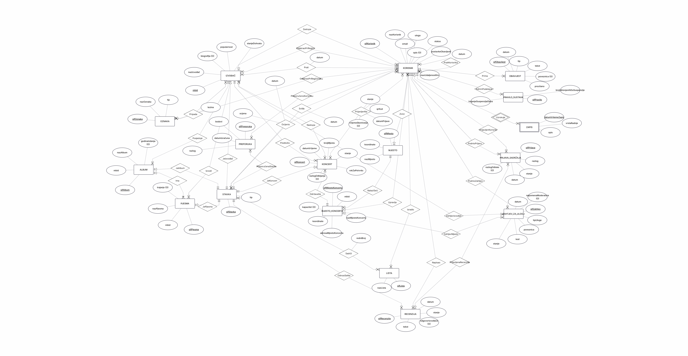

# Model podataka (ER dijagram)

Ovaj dokument opisuje konceptualni model podataka aplikacije Sonar. Dijagram je izrađen u alatu ERDPlus.

- Izvorna datoteka (može se ponovno urediti): [`er-dijagram.erdplus`](er-dijagram.erdplus)
- Slika dijagrama:

## 1. Pregled

| | Broj |
|---|---|
| Entiteti | 17 |
| Veze | 37 |
| Atributi | 87 |

Model prati funkcionalne zahtjeve iz projektnog zadatka. Entiteti su podijeljeni u šest cjelina:

1. korisnici i administracija (KORISNIK, ZAPIS, PRAVILO_SUSTAVA)
2. glazbeni katalog (IZVOĐAČ, ALBUM, PJESMA, OZNAKA)
3. mjesta (MJESTO, MJESTO_KONCERTA)
4. društveni dio (STAVKA, RECENZIJA, LISTA)
5. koncerti (KONCERT)
6. moderacija, uloge, obavijesti i preporuke (PRIJAVA_SADRŽAJA, ZAHTJEV_ZA_ULOGU, OBAVIJEST, PREPORUKA)

## 2. Kako čitati kardinalnosti

Oznaka uz entitet kaže **koliko tih entiteta dolazi na jedan primjerak druge strane veze**.

- `M` (mandatory) znači obavezno, a `O` (optional) neobavezno.
- `One` znači najviše jedan, a `Many` više njih.

## 3. Entiteti

U tablicama su atributi koji čine primarni ključ (ili djelomični ključ kod slabog entiteta) označeni s **(ključ)**, a neobavezni s *(neobvezan)*.

### 3.1 Korisnici i administracija

| Entitet | Atributi | Opis |
|---|---|---|
| **KORISNIK** | `sifKorisnik` **(ključ)**, `nazKorisnik`, `email`, `opis` *(neobvezan)*, `uloga`, `status`, `postavkeObavijesti`, `maxUdaljenostKm` | Svaka osoba u sustavu, bez obzira na ulogu. E-pošta se preuzima od Googlea. Uloga je atribut, a ne podtip, jer verificirani izvođač „uz to“ može sve što i slušatelj. Mjesto stanovanja je u vezi **ŽiviU**. |
| **ZAPIS** (slabi entitet) | `datumVrijemeZapis` **(djelomični ključ)**, `vrstaRadnje`, `opis` | Zapisnik moderatorskih radnji. Ključ mu je (korisnik, vrijeme), a veza **Uzrokuje** je identificirajuća. Moderatorske radnje su unaprijed poznate, pa je `vrstaRadnje` nabrajanje (odjeljak 5), a ne slobodan tekst. |
| **PRAVILO_SUSTAVA** | `sifPravilo` **(ključ)**, `brojUklonjenihDoSuspenzije`, `trajanjeSuspenzijeDana` | Parametri sustava koje podešava administrator. Ima jedan redak, a svaki parametar je zaseban atribut sa svojim tipom, umjesto općeg para naziv i vrijednost u koji se može upisati bilo što. Za sada zadatak traži samo pravilo suspenzije. Novi parametri dodaju se kao novi atributi kada zatrebaju. |

### 3.2 Glazbeni katalog

Katalog se puni iz MusicBrainza i Last.fma, a aplikacija pri radu čita samo iz vlastite baze.

| Entitet | Atributi | Opis |
|---|---|---|
| **IZVOĐAČ** | `mbid` **(ključ)**, `nazIzvođač`, `biografija` *(neobvezan)*, `popularnost`, `stanjeDohvata` | Izvođač iz kataloga. Postoji neovisno o korisničkim računima. Stanje dohvata prati dodavanje na zahtjev. Svaki izvođač je i STAVKA (veza **JeIzvođač**). |
| **ALBUM** | `sifAlbum` **(ključ)**, `mbid`, `nazAlbum`, `godinaIzdanja` *(neobvezan)* | Album izvođača. Svaki album je i STAVKA (veza **JeAlbum**). |
| **PJESMA** | `sifPjesma` **(ključ)**, `mbid`, `nazPjesma`, `trajanje` *(neobvezan)* | Pjesma jednog izvođača, a može i ne pripadati albumu (singl). Svaka pjesma je i STAVKA (veza **JePjesma**). |
| **OZNAKA** | `sifOznaka` **(ključ)**, `nazOznaka`, `tip` | Žanr ili raspoloženje (iz Last.fma). Last.fm oznake su namjerno slobodan tekst (npr. „disco“, „disco pop“), pa je `nazOznaka` običan tekst, a ne nabrajanje. `tip` određujemo sami pri uvozu. |

### 3.3 Mjesta

| Entitet | Atributi | Opis |
|---|---|---|
| **MJESTO_KONCERTA** | `sifMjestoKoncerta` **(ključ)**, `mbid`, `nazMjestoKoncerta`, `adresaMjestoKoncerta`, `koordinate`, `kapacitet` *(neobvezan)* | Klub ili dvorana iz kataloga. `kapacitet` je najveći broj posjetitelja koji mjesto prima. Unosi ga upravitelj mjesta, prikazuje se na profilu mjesta i gornja je granica za `KONCERT.brojMjesta`. Dok kapacitet nije unesen, na mjesto nije moguće predložiti koncert. |
| **MJESTO** | `sifMjesto` **(ključ)**, `nazMjesto`, `koordinate` | Grad. Služi za mjesto stanovanja korisnika i izračun udaljenosti do koncerata. Lokacija korisnika čuva se samo na razini grada. |

### 3.4 Društveni dio, koncerti i liste

| Entitet | Atributi | Opis |
|---|---|---|
| **STAVKA** | `sifStavka` **(ključ)**, `tip` | Zajednički nadentitet za sve što se može ocijeniti, označiti s „sviđa mi se“, recenzirati, staviti na listu ili preporučiti. Svaka stavka je točno jedan izvođač, album, pjesma ili koncert, a `tip` kaže koji. Zato ocjene, recenzije, liste i preporuke imaju po jednu vezu prema STAVCI, a ne po jednu vezu za svaku vrstu sadržaja. |
| **RECENZIJA** | `sifRecenzija` **(ključ)**, `tekst`, `datum`, `stanje`, `odgovorIzvođača` *(neobvezan)* | Recenzija izvođača, albuma ili pjesme (veza **OdnosiSeNa** prema STAVCI). Prijavljuje se, uklanja i na nju izvođač službeno odgovara. |
| **LISTA** | `sifLista` **(ključ)**, `nazLista` | Lista stavki koju izrađuje korisnik (npr. omiljene pjesme). Lista može sadržavati pjesme, albume, izvođače i koncerte. |
| **KONCERT** | `sifKoncert` **(ključ)**, `datumVrijeme`, `brojMjesta`, `stanje`, `rokZaPotvrdu`, `razlogOdbijanja` *(neobvezan)* | Koncert koji predlaže izvođač, a potvrđuje upravitelj mjesta. `brojMjesta` je broj mjesta za prijavu na tom koncertu i ne smije prelaziti kapacitet mjesta. Broj slobodnih mjesta se ne sprema, nego izvodi (odjeljak 6). Rok za potvrdu je trenutak nakon kojeg neobrađen prijedlog istječe. Svaki koncert je i STAVKA (veza **JeKoncert**), da bi se mogao preporučiti i staviti na listu. |

### 3.5 Moderacija, uloge, obavijesti i preporuke

| Entitet | Atributi | Opis |
|---|---|---|
| **PRIJAVA_SADRŽAJA** | `sifPrijava` **(ključ)**, `razlog`, `stanje`, `datum`, `razlogOdluke` *(neobvezan)* | Prijava neprimjerenog sadržaja (recenzije ili profila). |
| **ZAHTJEV_ZA_ULOGU** | `sifZahtjev` **(ključ)**, `tipUloge`, `poveznica`, `kod`, `stanje`, `napomenaModeratora` *(neobvezan)*, `datum` | Zahtjev za ulogu izvođača ili upravitelja mjesta. Korisnik objavljuje izdani `kod` na službenoj stranici ili profilu, a moderator ga provjerava. |
| **OBAVIJEST** | `sifObavijest` **(ključ)**, `tip`, `tekst`, `poveznica` *(neobvezan)*, `procitano`, `datum` | Obavijest prikazana unutar aplikacije. |
| **PREPORUKA** | `sifPreporuka` **(ključ)**, `razlog`, `bodovi`, `datumIzračuna` | Izračunata preporuka jedne stavke jednom korisniku, s razlogom koji se prikazuje (npr. „jer voliš X“). Jedan entitet pokriva preporuke izvođača i koncerata, a bez promjene modela i albuma i pjesama. |

## 4. Veze

| Veza | Entiteti i kardinalnosti | Atributi veze | Značenje |
|---|---|---|---|
| **Posjeduje** | IZVOĐAČ (M,One) – ALBUM (O,Many) | | Album pripada točno jednom izvođaču. |
| **Ima** | ALBUM (O,One) – PJESMA (M,Many) | | Pjesma je na najviše jednom albumu, a album ima barem jednu pjesmu. |
| **Izvodi** | IZVOĐAČ (M,One) – PJESMA (O,Many) | | Svaka pjesma ima točno jednog izvođača, čak i bez albuma. |
| **Pripada** | IZVOĐAČ (O,Many) – OZNAKA (O,Many) | `tezina` | Oznake izvođača i koliko dobro opisuju izvođača. |
| **JeIzvođač** | IZVOĐAČ (O,One) – STAVKA (M,One) | | Izvođač kao stavka. |
| **JeAlbum** | ALBUM (O,One) – STAVKA (M,One) | | Album kao stavka. |
| **JePjesma** | PJESMA (O,One) – STAVKA (M,One) | | Pjesma kao stavka. |
| **JeKoncert** | KONCERT (O,One) – STAVKA (M,One) | | Koncert kao stavka. |
| **OdabraoPriRegOznaku** | KORISNIK (O,Many) – OZNAKA (O,Many) | | Žanrovi odabrani pri registraciji. |
| **OdabraoPriRegIzv** | KORISNIK (O,Many) – IZVOĐAČ (O,Many) | | Izvođači odabrani pri registraciji. |
| **Prati** | KORISNIK (O,Many) – IZVOĐAČ (O,Many) | `datum` | Korisnik prati izvođača. |
| **PratiKorisnika** | KORISNIK (O,Many) – KORISNIK (O,Many) | `datum` | Korisnik prati drugog korisnika (unarna veza). |
| **Ocijenio** | KORISNIK (O,Many) – STAVKA (O,Many) | `ocjena`, `datum` | Ocjena od 1 do 5 za izvođača, album ili pjesmu. Ocjena je obavezna: ako zapis postoji, ocjena postoji. |
| **Sviđa** | KORISNIK (O,Many) – STAVKA (O,Many) | `datum` | Oznaka „sviđa mi se“ za izvođača, album ili pjesmu. Postojanje zapisa znači „sviđa mi se“, a uklanjanje oznake briše zapis. Neovisna je o ocjeni (F-012), pa je zasebna veza, a ne neobvezan atribut uz ocjenu. |
| **Napisao** | KORISNIK (M,One) – RECENZIJA (O,Many) | | Svaka recenzija ima točno jednog autora. |
| **OdnosiSeNa** | STAVKA (M,One) – RECENZIJA (O,Many) | | Recenzija se odnosi na točno jednu stavku (izvođača, album ili pjesmu). |
| **Zastupa** | KORISNIK (O,Many) – IZVOĐAČ (O,One) | | Verificirani izvođač zastupa jednog izvođača iz kataloga. Izvođača može zastupati više korisnika (npr. članovi benda). |
| **Upravlja** | KORISNIK (O,Many) – MJESTO_KONCERTA (O,One) | | Verificirani upravitelj zastupa jedno mjesto. Mjesto iz kataloga može biti bez upravitelja. |
| **ŽiviU** | KORISNIK (O,Many) – MJESTO (O,One) | | Mjesto stanovanja korisnika. |
| **NalaziSeU** | MJESTO (M,One) – MJESTO_KONCERTA (O,Many) | | Svako mjesto održavanja nalazi se u jednom gradu. |
| **OdržavaSe** | KONCERT (O,Many) – MJESTO_KONCERTA (M,One) | | Koncert se održava na točno jednom mjestu. |
| **Predložio** | KONCERT (O,Many) – IZVOĐAČ (M,One) | | Izvođač koji je predložio koncert. |
| **Nastupa** | KONCERT (O,Many) – IZVOĐAČ (M,Many) | | Izvođači koji nastupaju (barem jedan). |
| **PrijavljenNa** | KORISNIK (O,Many) – KONCERT (O,Many) | `stanje`, `qrKod`, `datumPrijave`, `vrijemeSkeniranja` *(neobvezan)* | Prijava slušatelja na koncert. Stanje prijave, QR ulaznica i vrijeme skeniranja pri ulazu. |
| **Izradio** | KORISNIK (M,One) – LISTA (O,Many) | | Autor liste. |
| **Sadrži** | LISTA (O,Many) – STAVKA (O,Many) | `redniBroj` | Stavke na listi i njihov redoslijed. |
| **PodnioPrijavu** | KORISNIK (M,One) – PRIJAVA_SADRŽAJA (O,Many) | | Korisnik koji je prijavio sadržaj. |
| **PrijavljenaRecenzija** | PRIJAVA_SADRŽAJA (O,Many) – RECENZIJA (O,One) | | Prijava se odnosi na recenziju. |
| **PrijavljenKorisnik** | PRIJAVA_SADRŽAJA (O,Many) – KORISNIK (O,One) | | Prijava se odnosi na korisnika (profil). |
| **PodnioZahtjev** | KORISNIK (M,One) – ZAHTJEV_ZA_ULOGU (O,Many) | | Korisnik koji traži ulogu. |
| **ZahtjevIzvođač** | ZAHTJEV_ZA_ULOGU (O,Many) – IZVOĐAČ (O,One) | | Izvođač za kojeg se traži uloga. |
| **ZahtjevMjesto** | ZAHTJEV_ZA_ULOGU (O,Many) – MJESTO_KONCERTA (O,One) | | Mjesto za koje se traži uloga upravitelja. |
| **Prima** | KORISNIK (M,One) – OBAVIJEST (O,Many) | | Primatelj obavijesti. |
| **PreporučenoKorisniku** | KORISNIK (M,One) – PREPORUKA (O,Many) | | Korisnik kojem je preporuka namijenjena. |
| **PreporučenaStavka** | STAVKA (M,One) – PREPORUKA (O,Many) | | Stavka koja se preporučuje (izvođač ili koncert, a po potrebi i album ili pjesma). |
| **Uzrokuje** | KORISNIK (M,One) – ZAPIS (O,Many) | | Moderator koji je izvršio radnju. Identificirajuća veza slabog entiteta ZAPIS. |
| **AdminPodešava** | KORISNIK (O,Many) – PRAVILO_SUSTAVA (O,Many) | | Administrator koji podešava pravila sustava. |

## 5. Vrijednosti stanja

Vrijednosti se u bazi zapisuju malim slovima, bez dijakritičkih znakova i s podvlakom umjesto razmaka (npr. `upravitelj_mjesta`).

| Atribut | Dopuštene vrijednosti |
|---|---|
| `KORISNIK.uloga` | `slusatelj`, `izvodjac`, `upravitelj_mjesta`, `moderator`, `administrator` |
| `KORISNIK.status` | `aktivan`, `suspendiran`, `deaktiviran`, `obrisan` |
| `IZVOĐAČ.stanjeDohvata` | `u_obradi`, `dohvacen`, `neuspjelo` |
| `OZNAKA.tip` | `zanr`, `raspolozenje` |
| `STAVKA.tip` | `izvodjac`, `album`, `pjesma`, `koncert` |
| `KONCERT.stanje` | `predlozen`, `potvrden`, `otvorene_prijave`, `odrzan`, `odbijen`, `istekao`, `otkazan` |
| `PrijavljenNa.stanje` | `prijavljen`, `dosao`, `nije_dosao`, `otkazan` |
| `RECENZIJA.stanje` | `vidljiva`, `uklonjena` |
| `PRIJAVA_SADRŽAJA.stanje` | `prijavljeno`, `u_obradi`, `uklonjeno`, `odbaceno` |
| `ZAHTJEV_ZA_ULOGU.stanje` | `zahtjev`, `provjera`, `potrebna_dopuna`, `potvrden`, `odbijen` |
| `ZAHTJEV_ZA_ULOGU.tipUloge` | `izvodjac`, `upravitelj_mjesta` |
| `ZAPIS.vrstaRadnje` | `uklanjanje_sadrzaja`, `odbacivanje_prijave`, `potvrda_zahtjeva`, `odbijanje_zahtjeva`, `trazenje_dopune` |

## 6. Izvedeni podaci i čuvanje podataka

- **Feed** nema vlastitu tablicu. Sastavlja se upitom nad ocjenama, recenzijama, koncertima i praćenjima te sortira po datumu. Zato ti entiteti imaju atribut `datum`.
- **Broj slobodnih mjesta** na koncertu se ne sprema. Računa se kao `brojMjesta` umanjen za broj prijava u stanju `prijavljen` ili `dosao`. Prijava na koncert izvodi se u transakciji koja zaključava redak koncerta, pa ni istodobne prijave ne mogu premašiti broj mjesta (NF-07).
- **Statistika** (prijave, dolasci, nedolasci, ocjene, pratitelji u blizini mjesta, odaziv) računa se upitima.
- **Preporuke** (entitet **PREPORUKA**) pozadinski posao računa jednom na sat i upisuje za svakog korisnika najviše 20 do 50 najboljih, a stare zamjenjuje novima, pa tablica ne raste s aktivnošću korisnika. Zadatak traži preporuke izvođača i koncerata. Budući da se preporuka odnosi na STAVKU, preporuke albuma i pjesama mogu se dodati bez promjene modela.
- **Obavijesti i obrađene prijave sadržaja** čiste se periodično (npr. pročitane obavijesti starije od 90 dana).
- **Brisanje korisničkog računa** anonimizira redak korisnika (briše e-poštu, ime, opis i lokaciju te praćenja, oznake „sviđa mi se“, liste, obavijesti i preporuke), a recenzije, ocjene i prijave na koncerte ostaju anonimne. Zapisnik moderatora ostaje cijeli.

## 7. Ograničenja koja ER dijagram ne može izraziti

Ova pravila ugrađujemo u bazu (ograničenja, okidači) ili u aplikaciju:

1. **Stavka je točno jednog podtipa**: na nju se veže točno jedan izvođač, album, pjesma ili koncert, i to onaj koji navodi `STAVKA.tip`.
2. **Ocjene, oznake „sviđa mi se“ i recenzije** dopuštene su samo za stavke tipa `izvodjac`, `album` i `pjesma`. Na listi i u preporukama može biti stavka bilo kojeg tipa.
3. **Jedinstvenost** atributa `kod` (ZAHTJEV_ZA_ULOGU), `qrKod` (PrijavljenNa) i `mbid` (ALBUM, PJESMA, MJESTO_KONCERTA) te para (korisnik, stavka) u PREPORUCI.
4. **Ocjena je od 1 do 5**, a korisnik jednu stavku ocjenjuje najviše jednom i najviše jednom označava s „sviđa mi se“.
5. **Broj mjesta koncerta ne smije prelaziti kapacitet mjesta**, a na mjesto bez kapaciteta nije moguće predložiti koncert.
6. **Prijava na koncert** dopuštena je samo u stanju otvorenih prijava i dok ima slobodnih mjesta.
7. **Otkazivanje prijave** moguće je najkasnije sat vremena prije početka koncerta.
8. **Jedna aktivna prijava po korisniku i koncertu** (jedinstvenost para, uz izuzetak otkazanih prijava).
9. **Korisnik ne može pratiti sam sebe.**
10. **Veze Zastupa i Upravlja** moguće su samo za korisnike s odgovarajućom ulogom, a dodjeljuje ih moderator nakon provjere zahtjeva.
11. **Privremena suspenzija** nakon zadanog broja uklonjenih sadržaja. Broj i trajanje podešava administrator (`PRAVILO_SUSTAVA`).
12. **Prijedlog koncerta istječe** ako ga upravitelj ne obradi do `rokZaPotvrdu`.
13. **Dopuštene vrijednosti stanja** (odjeljak 5) izražavaju se nabrajanjem ili s `CHECK`.

## 8. Otvorena pitanja

Bilješke iz pregleda koje za sada ne mijenjaju model, ali ih treba imati na umu:

- **Komentari.** Na recenziju za sada postoji samo jedan službeni odgovor izvođača (`odgovorIzvođača`). Ako budemo htjeli općenite komentare (više odgovora, i od drugih korisnika), odgovor treba izdvojiti u zaseban entitet KOMENTAR.
- **Novi parametri sustava** (npr. rok za potvrdu prijedloga ili prag za zbirni prikaz pratitelja) dodaju se kao novi atributi entiteta PRAVILO_SUSTAVA kada ih administrator bude trebao mijenjati.
