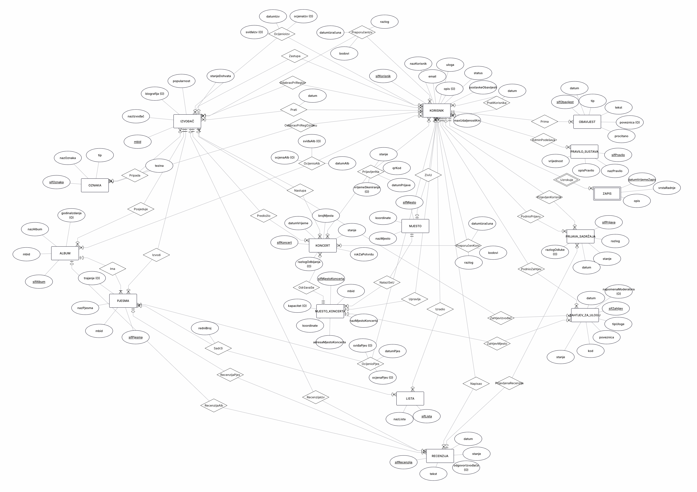

# Model podataka (ER dijagram)

Ovaj dokument opisuje konceptualni model podataka aplikacije Sonar. Dijagram je izrađen u alatu ERDPlus.

- Izvorna datoteka (može se ponovno urediti): [`er-dijagram.erdplus`](er-dijagram.erdplus)
- Slika dijagrama:

## 1. Pregled

| | Broj |
|---|---|
| Entiteti | 15 |
| Veze | 36 |
| Atributi | 94 |

Model prati funkcionalne zahtjeve iz projektnog zadatka. Entiteti su podijeljeni u šest cjelina:

1. korisnici i administracija (KORISNIK, ZAPIS, PRAVILO_SUSTAVA)
2. glazbeni katalog (IZVOĐAČ, ALBUM, PJESMA, OZNAKA)
3. mjesta (MJESTO, MJESTO_KONCERTA)
4. društveni dio (RECENZIJA, LISTA)
5. koncerti (KONCERT)
6. moderacija, uloge i obavijesti (PRIJAVA_SADRŽAJA, ZAHTJEV_ZA_ULOGU, OBAVIJEST)

## 2. Kako čitati kardinalnosti

Oznaka uz entitet kaže **koliko tih entiteta dolazi na jedan primjerak druge strane veze**.

- `M` (mandatory) znači obavezno, a `O` (optional) neobavezno.
- `One` znači najviše jedan, a `Many` više njih.

## 3. Entiteti

U tablicama su atributi koji čine primarni ključ (ili djelomični ključ kod slabog entiteta) označeni s **(ključ)**, a neobavezni s *(neobvezan)*.

### 3.1 Korisnici i administracija

| Entitet | Atributi | Opis |
|---|---|---|
| **KORISNIK** | `sifKorisnik` **(ključ)**, `nazKorisnik`, `email`, `opis` *(neobvezan)*, `uloga`, `status`, `postavkeObavijesti`, `maxUdaljenostKm` | Svaka osoba u sustavu, bez obzira na ulogu. E-pošta se preuzima od Googlea. Uloga je atribut, a ne podtip, jer verificirani izvođač „uz to“ može sve što i slušatelj. Mjesto stanovanja je u vezi **ŽiviU**. |
| **ZAPIS** (slabi entitet) | `datumVrijemeZapis` **(djelomični ključ)**, `vrstaRadnje`, `opis` | Zapisnik moderatorskih radnji. Ključ mu je (korisnik, vrijeme), a veza **Uzrokuje** je identificirajuća. |
| **PRAVILO_SUSTAVA** | `sifPravilo` **(ključ)**, `nazPravilo`, `opisPravilo`, `vrijednost` | Parametri koje podešava administrator, npr. broj uklonjenih sadržaja do suspenzije i trajanje suspenzije. |

### 3.2 Glazbeni katalog

Katalog se puni iz MusicBrainza i Last.fma, a aplikacija pri radu čita samo iz vlastite baze.

| Entitet | Atributi | Opis |
|---|---|---|
| **IZVOĐAČ** | `mbid` **(ključ)**, `nazIzvođač`, `biografija` *(neobvezan)*, `popularnost`, `stanjeDohvata` | Izvođač iz kataloga. Postoji neovisno o korisničkim računima. Stanje dohvata prati dodavanje na zahtjev. |
| **ALBUM** | `sifAlbum` **(ključ)**, `mbid`, `nazAlbum`, `godinaIzdanja` *(neobvezan)* | Album izvođača. |
| **PJESMA** | `sifPjesma` **(ključ)**, `mbid`, `nazPjesma`, `trajanje` *(neobvezan)* | Pjesma jednog izvođača, a može i ne pripadati albumu (singl). |
| **OZNAKA** | `sifOznaka` **(ključ)**, `nazOznaka`, `tip` | Žanr ili raspoloženje (iz Last.fma). |

### 3.3 Mjesta

| Entitet | Atributi | Opis |
|---|---|---|
| **MJESTO_KONCERTA** | `sifMjestoKoncerta` **(ključ)**, `mbid`, `nazMjestoKoncerta`, `adresaMjestoKoncerta`, `koordinate`, `kapacitet` *(neobvezan)* | Klub ili dvorana iz kataloga. Dok kapacitet nije unesen, na mjesto nije moguće predložiti koncert. |
| **MJESTO** | `sifMjesto` **(ključ)**, `nazMjesto`, `koordinate` | Grad. Služi za mjesto stanovanja korisnika i izračun udaljenosti do koncerata. Lokacija korisnika čuva se samo na razini grada. |

### 3.4 Društveni dio, koncerti i liste

| Entitet | Atributi | Opis |
|---|---|---|
| **RECENZIJA** | `sifRecenzija` **(ključ)**, `tekst`, `datum`, `stanje`, `odgovorIzvođača` *(neobvezan)* | Recenzija izvođača, albuma ili pjesme. Prijavljuje se, uklanja i na nju izvođač službeno odgovara. |
| **LISTA** | `sifLista` **(ključ)**, `nazLista` | Lista pjesama koju izrađuje korisnik (npr. omiljene pjesme). |
| **KONCERT** | `sifKoncert` **(ključ)**, `datumVrijeme`, `brojMjesta`, `stanje`, `rokZaPotvrdu`, `razlogOdbijanja` *(neobvezan)* | Koncert koji predlaže izvođač, a potvrđuje upravitelj mjesta. Broj mjesta za prijavu ne smije prelaziti kapacitet mjesta. Rok za potvrdu je trenutak nakon kojeg neobrađen prijedlog istječe. |

### 3.5 Moderacija, uloge i obavijesti

| Entitet | Atributi | Opis |
|---|---|---|
| **PRIJAVA_SADRŽAJA** | `sifPrijava` **(ključ)**, `razlog`, `stanje`, `datum`, `razlogOdluke` *(neobvezan)* | Prijava neprimjerenog sadržaja (recenzije ili profila). |
| **ZAHTJEV_ZA_ULOGU** | `sifZahtjev` **(ključ)**, `tipUloge`, `poveznica`, `kod`, `stanje`, `napomenaModeratora` *(neobvezan)*, `datum` | Zahtjev za ulogu izvođača ili upravitelja mjesta. Korisnik objavljuje izdani `kod` na službenoj stranici ili profilu, a moderator ga provjerava. |
| **OBAVIJEST** | `sifObavijest` **(ključ)**, `tip`, `tekst`, `poveznica` *(neobvezan)*, `procitano`, `datum` | Obavijest prikazana unutar aplikacije. |

## 4. Veze

| Veza | Entiteti i kardinalnosti | Atributi veze | Značenje |
|---|---|---|---|
| **Posjeduje** | IZVOĐAČ (M,One) – ALBUM (O,Many) | | Album pripada točno jednom izvođaču. |
| **Ima** | ALBUM (O,One) – PJESMA (M,Many) | | Pjesma je na najviše jednom albumu, a album ima barem jednu pjesmu. |
| **Izvodi** | IZVOĐAČ (M,One) – PJESMA (O,Many) | | Svaka pjesma ima točno jednog izvođača, čak i bez albuma. |
| **Pripada** | IZVOĐAČ (O,Many) – OZNAKA (O,Many) | `tezina` | Oznake izvođača i koliko dobro opisuju izvođača. |
| **OdabraoPriRegOznaku** | KORISNIK (O,Many) – OZNAKA (O,Many) | | Žanrovi odabrani pri registraciji. |
| **OdabraoPriRegIzv** | KORISNIK (O,Many) – IZVOĐAČ (O,Many) | | Izvođači odabrani pri registraciji. |
| **Prati** | KORISNIK (O,Many) – IZVOĐAČ (O,Many) | `datum` | Korisnik prati izvođača. |
| **PratiKorisnika** | KORISNIK (O,Many) – KORISNIK (O,Many) | `datum` | Korisnik prati drugog korisnika (unarna veza). |
| **OcijenioIzv** | KORISNIK (O,Many) – IZVOĐAČ (O,Many) | `ocjenaIzv` *(neobvezan)*, `sviđaIzv` *(neobvezan)*, `datumIzv` | Ocjena (1 do 5) i oznaka „sviđa mi se“ za izvođača. Ako korisnik samo označi „sviđa mi se“, ocjena može biti prazna i obrnuto. |
| **OcijenioAlb** | KORISNIK (O,Many) – ALBUM (O,Many) | `ocjenaAlb` *(neobvezan)*, `sviđaAlb` *(neobvezan)*, `datumAlb` | Isto za album. |
| **OcijenioPjes** | KORISNIK (O,Many) – PJESMA (O,Many) | `ocjenaPjes` *(neobvezan)*, `sviđaPjes` *(neobvezan)*, `datumPjes` | Isto za pjesmu. |
| **Napisao** | KORISNIK (M,One) – RECENZIJA (O,Many) | | Svaka recenzija ima točno jednog autora. |
| **RecenzijaIzv** | IZVOĐAČ (O,One) – RECENZIJA (O,Many) | | Recenzija se odnosi na izvođača. |
| **RecenzijaAlb** | ALBUM (O,One) – RECENZIJA (O,Many) | | Recenzija se odnosi na album. |
| **RecenzijaPjes** | PJESMA (O,One) – RECENZIJA (O,Many) | | Recenzija se odnosi na pjesmu. |
| **Zastupa** | KORISNIK (O,Many) – IZVOĐAČ (O,One) | | Verificirani izvođač zastupa jednog izvođača iz kataloga. Izvođača može zastupati više korisnika (npr. članovi benda). |
| **Upravlja** | KORISNIK (O,Many) – MJESTO_KONCERTA (O,One) | | Verificirani upravitelj zastupa jedno mjesto. Mjesto iz kataloga može biti bez upravitelja. |
| **ŽiviU** | KORISNIK (O,Many) – MJESTO (O,One) | | Mjesto stanovanja korisnika. |
| **NalaziSeU** | MJESTO (M,One) – MJESTO_KONCERTA (O,Many) | | Svako mjesto održavanja nalazi se u jednom gradu. |
| **OdržavaSe** | KONCERT (O,Many) – MJESTO_KONCERTA (M,One) | | Koncert se održava na točno jednom mjestu. |
| **Predložio** | KONCERT (O,Many) – IZVOĐAČ (M,One) | | Izvođač koji je predložio koncert. |
| **Nastupa** | KONCERT (O,Many) – IZVOĐAČ (M,Many) | | Izvođači koji nastupaju (barem jedan). |
| **PrijavljenNa** | KORISNIK (O,Many) – KONCERT (O,Many) | `stanje`, `qrKod`, `datumPrijave`, `vrijemeSkeniranja` *(neobvezan)* | Prijava slušatelja na koncert. Stanje prijave, QR ulaznica i vrijeme skeniranja pri ulazu. |
| **Izradio** | KORISNIK (M,One) – LISTA (O,Many) | | Autor liste. |
| **Sadrži** | LISTA (O,Many) – PJESMA (O,Many) | `redniBroj` | Pjesme na listi i njihov redoslijed. |
| **PodnioPrijavu** | KORISNIK (M,One) – PRIJAVA_SADRŽAJA (O,Many) | | Korisnik koji je prijavio sadržaj. |
| **PrijavljenaRecenzija** | PRIJAVA_SADRŽAJA (O,Many) – RECENZIJA (O,One) | | Prijava se odnosi na recenziju. |
| **PrijavljenKorisnik** | PRIJAVA_SADRŽAJA (O,Many) – KORISNIK (O,One) | | Prijava se odnosi na korisnika (profil). |
| **PodnioZahtjev** | KORISNIK (M,One) – ZAHTJEV_ZA_ULOGU (O,Many) | | Korisnik koji traži ulogu. |
| **ZahtjevIzvođač** | ZAHTJEV_ZA_ULOGU (O,Many) – IZVOĐAČ (O,One) | | Izvođač za kojeg se traži uloga. |
| **ZahtjevMjesto** | ZAHTJEV_ZA_ULOGU (O,Many) – MJESTO_KONCERTA (O,One) | | Mjesto za koje se traži uloga upravitelja. |
| **Prima** | KORISNIK (M,One) – OBAVIJEST (O,Many) | | Primatelj obavijesti. |
| **PreporučenIzv** | KORISNIK (O,Many) – IZVOĐAČ (O,Many) | `razlog`, `bodovi`, `datumIzračuna` | Izračunata preporuka izvođača s razlogom (npr. „jer voliš X“). |
| **PreporučenKonc** | KORISNIK (O,Many) – KONCERT (O,Many) | `razlog`, `bodovi`, `datumIzračuna` | Izračunata preporuka koncerta. |
| **Uzrokuje** | KORISNIK (M,One) – ZAPIS (O,Many) | | Moderator koji je izvršio radnju. Identificirajuća veza slabog entiteta ZAPIS. |
| **AdminPodešava** | KORISNIK (O,Many) – PRAVILO_SUSTAVA (O,Many) | | Administrator koji podešava pravila sustava. |

## 5. Vrijednosti stanja

| Atribut | Dopuštene vrijednosti |
|---|---|
| `KORISNIK.uloga` | slušatelj, izvođač, upravitelj mjesta, moderator, administrator |
| `KORISNIK.status` | aktivan, suspendiran, deaktiviran, obrisan |
| `IZVOĐAČ.stanjeDohvata` | u obradi, dohvaćen, neuspjelo |
| `OZNAKA.tip` | žanr, raspoloženje |
| `KONCERT.stanje` | predložen, potvrđen, otvorene prijave, održan, odbijen, istekao, otkazan |
| `PrijavljenNa.stanje` | prijavljen, došao, nije došao, otkazan |
| `RECENZIJA.stanje` | vidljiva, uklonjena |
| `PRIJAVA_SADRŽAJA.stanje` | prijavljeno, u obradi, uklonjeno, odbačeno |
| `ZAHTJEV_ZA_ULOGU.stanje` | zahtjev, provjera, potrebna dopuna, potvrđen, odbijen |
| `ZAHTJEV_ZA_ULOGU.tipUloge` | izvođač, upravitelj mjesta |

## 6. Izvedeni podaci i čuvanje podataka

- **Feed** nema vlastitu tablicu. Sastavlja se upitom nad ocjenama, recenzijama, koncertima i praćenjima te sortira po datumu. Zato ti entiteti imaju atribut `datum`.
- **Statistika** (prijave, dolasci, nedolasci, ocjene, pratitelji u blizini mjesta, odaziv) računa se upitima.
- **Preporuke** (veze **PreporučenIzv** i **PreporučenKonc**) pozadinski posao računa jednom na sat i upisuje za svakog korisnika najviše 20 do 50 najboljih, a stare zamjenjuje novima, pa tablice ne rastu s aktivnošću korisnika. Zadatak kaže da se preporuke spremaju zajedno s razlogom, pa su u bazi tablice, a na dijagramu su prikazane kao veze.
- **Obavijesti i obrađene prijave sadržaja** čiste se periodično (npr. pročitane obavijesti starije od 90 dana).
- **Brisanje korisničkog računa** anonimizira redak korisnika (briše e-poštu, ime, opis i lokaciju te praćenja, oznake „sviđa mi se“, liste, obavijesti i preporuke), a recenzije, ocjene i prijave na koncerte ostaju anonimne. Zapisnik moderatora ostaje cijeli.

## 7. Ograničenja koja ER dijagram ne može izraziti

Ova pravila ugrađujemo u bazu (ograničenja, okidači) ili u aplikaciju:

1. **Recenzija se odnosi na točno jednu stavku** od tri (izvođač, album ili pjesma).
2. **Jedinstvenost** atributa `kod` (ZAHTJEV_ZA_ULOGU), `qrKod` (PrijavljenNa) i `mbid` (ALBUM, PJESMA, MJESTO_KONCERTA).
3. **Ocjena je od 1 do 5**, a korisnik jednu stavku ocjenjuje najviše jednom.
4. **Broj mjesta koncerta ne smije prelaziti kapacitet mjesta**, a na mjesto bez kapaciteta nije moguće predložiti koncert.
5. **Prijava na koncert** dopuštena je samo u stanju otvorenih prijava i dok ima slobodnih mjesta.
6. **Otkazivanje prijave** moguće je najkasnije sat vremena prije početka koncerta.
7. **Jedna aktivna prijava po korisniku i koncertu** (jedinstvenost para, uz izuzetak otkazanih prijava).
8. **Korisnik ne može pratiti sam sebe.**
9. **Veze Zastupa i Upravlja** moguće su samo za korisnike s odgovarajućom ulogom, a dodjeljuje ih moderator nakon provjere zahtjeva.
10. **Privremena suspenzija** nakon zadanog broja uklonjenih sadržaja. Broj i trajanje podešava administrator (`PRAVILO_SUSTAVA`).
11. **Prijedlog koncerta istječe** ako ga upravitelj ne obradi do `rokZaPotvrdu`.
12. **Dopuštene vrijednosti stanja** (odjeljak 5) izražavaju se s `CHECK`.
